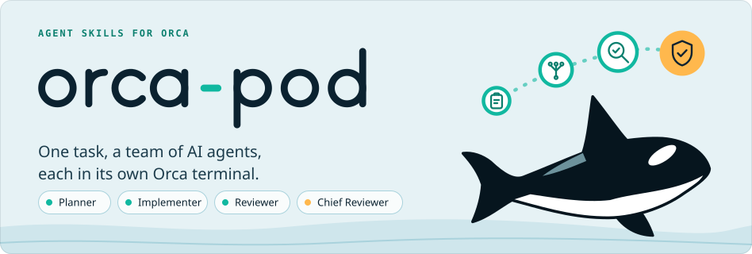
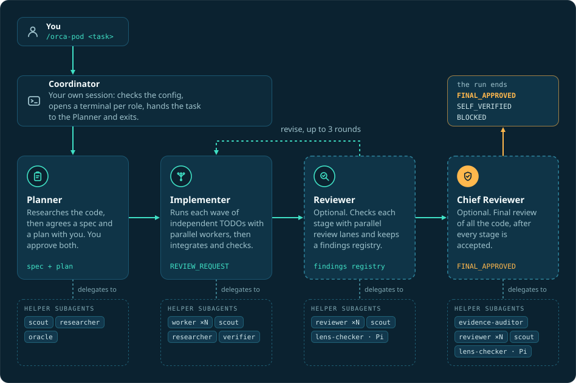

<p align="right"><b>English</b> · <a href="README.ru.md">Русский</a></p>

<h1 align="center">
  <picture>
    <source media="(prefers-color-scheme: dark)" srcset="assets/hero-dark.svg">
    
  </picture>
</h1>

<p align="center">
  <a href="#install"></a>
  
  <a href="LICENSE"></a>
</p>

<p align="center">
  <a href="#quick-start">Quick start</a> ·
  <a href="#how-it-works">How it works</a> ·
  <a href="#why">Why</a> ·
  <a href="#plan-blitz">Plan blitz</a> ·
  <a href="#test-mode">Test mode</a> ·
  <a href="#configuration">Configuration</a> ·
  <a href="#troubleshooting">Troubleshooting</a>
</p>

**orca-pod** is built for [Orca](https://www.onorca.dev), the app that opens and manages AI agent terminals. orca-pod
runs one coding task through a team of AI agents. A **Planner** works out a spec (what to build) and a plan (the steps)
with you. An **Implementer** carries the plan out, handing independent steps to helper subagents
that work in parallel. Optional **Reviewer** and **Chief Reviewer** roles then check the result stage by stage.
Each role runs in its own Orca terminal and can use Claude Code, Codex or Pi with its own model and thinking level
(how much the model reasons before it answers).

Use it for a task big enough to need an approved plan before any code is written.

The repository contains three agent skills. A skill is a folder of instructions that your coding agent loads when
you type its name, for example `/orca-pod`:

| Skill | What it does for you |
| --- | --- |
| [`orca-pod`](skills/orca-pod/README.md) | Runs a task. The session where you start it acts as the Coordinator: it opens one Orca terminal per role and hands the task to the Planner. |
| [`orca-pod-setup`](skills/orca-pod-setup/README.md) | Writes the project's config file, `.orca-pod/orca-pod.yaml`, through a browser form. |
| [`plan-blitz`](skills/plan-blitz/README.md) | Walks you through a spec or a plan before you approve it, with multiple-choice questions only where there is a real choice. |

## Quick start

**1. Install.** You need [Orca](https://www.onorca.dev) (the app that runs the agent terminals; its `orca` command must be on `PATH`),
Node.js 18 or newer and git; [Requirements](#requirements) lists the rest.

```bash
npx skills add Salesao/orca-pod -g -y -s orca-pod orca-pod-setup plan-blitz -a claude-code codex pi
```

**2. Configure.** Open your project in the agent and run the setup skill. It writes `.orca-pod/orca-pod.yaml`
through a browser form.

**3. Run a task.** Give it a description, or the path of a RAF task file (your raw, unpolished spec in your own words;
the Planner turns it into a proper spec and plan). A path takes priority over text.

```
/orca-pod Add CSV export to the reports page
```

| | Claude Code | Codex | Pi |
| --- | --- | --- | --- |
| **Configure** | `/orca-pod-setup` | `$orca-pod-setup` | `/skill:orca-pod-setup` |
| **Run** | `/orca-pod <task>` | `$orca-pod <task>` | `/skill:orca-pod <task>` |

Then switch to the Planner terminal in Orca. The Planner writes the spec and the plan and asks you multiple-choice
questions before each approval (a [plan blitz](#plan-blitz)); after you approve, the Implementer carries the plan
out. The run ends with one of three statuses: `FINAL_APPROVED` (the final reviewer approved), `SELF_VERIFIED` (there
are no reviewers and the Implementer's self-check passed) or `BLOCKED` (the review did not reach agreement; you
decide). Not ready for real work? Try the built-in demo first: [Test mode](#test-mode). More in
[Install](#install), [First run](#first-run) and [Running a task](#running-a-task).

## How it works

<p align="center">
  
</p>

<details>
<summary>Text version of the diagram</summary>

```
You ── /orca-pod <task> ──▶ Coordinator    your own session: checks the config, opens the role terminals,
                                │          hands the task to the Planner and exits
                                ▼
                            Planner        spec + plan (waves of independent TODOs) - you approve them
                                │
                                ▼
                          Implementer      runs each wave with parallel workers, integrates, runs the checks
                                │ one review request per stage
                                ▼
                            Reviewer       parallel review lanes + findings registry          (optional)
                                │ accepted stages
                                ▼
                         Chief Reviewer    final review of all the code, FINAL_APPROVED       (optional)
```

</details>

<details>
<summary>Terms used in this README</summary>

- **Skill**: a folder of instructions (a `SKILL.md` file) that a coding agent loads when you type its name.
- **Orca**: the app that opens and manages the agent terminals; its command is `orca`.
- **Coordinator**: the session where you start `/orca-pod`. It checks the config, opens one terminal per role, hands the task to the Planner and exits.
- **Subagent**: a helper agent that a role starts for part of its work. A **worker** is the subagent that carries out one TODO.
- **TODO, wave, stage**: a TODO is one step of the plan. A wave is a group of TODOs that do not depend on each other and run in parallel; the waves run one after another. A stage is a group of waves that is reviewed together.
- **Lane**: one parallel slice of a review.
- **RAF task file**: your own rough spec, as you described the task: unstructured, even dictated. You pass its path instead of typing the task, and the Planner turns it into a proper spec and plan.
- **Profile**: a named set of roles, agents, models and limits in the config.

</details>

## Why

- **Plan first.** Nothing is implemented before you approve a spec and a plan.
- **Parallel implementation.** The plan is split into waves: groups of independent TODOs (plan steps) that change
  different files. The Implementer hands each TODO of a wave to its own worker subagent and runs the waves one after
  another.
- **No tests unless you ask.** The roles do not write, change or run tests and do not follow TDD; the checks are
  static (analyzer, linter, typecheck). Ask for tests in the task or tell the Planner, and the plan includes them.
- **Batch review.** Reviewers get one request per stage and check it with parallel lanes. Findings go into a
  registry, and only `BLOCKER` and `MAJOR` findings block. Review is bounded: a Reviewer gets up to 3 rounds per
  stage and a Chief Reviewer up to 2 attempts (3 when it is the only reviewer); if it does not converge the run ends
  `BLOCKED` and you decide.
- **Your choice of review depth**, set by which review roles are in the profile:

  | Roles configured | Mode | Final verdict |
  | --- | --- | --- |
  | Reviewer + Chief Reviewer | `full` | Chief Reviewer, `FINAL_APPROVED` |
  | Reviewer only | `reviewer` | Reviewer, `FINAL_APPROVED` |
  | Chief Reviewer only | `chief` | Chief Reviewer, `FINAL_APPROVED` |
  | none | `self` | Implementer self-check, `SELF_VERIFIED` |

## Requirements

Everyone needs:

- **[Orca](https://www.onorca.dev)** with its `orca` command on `PATH`. All roles live in Orca terminals; orca-pod does not work without it.
- **The `orca-cli` skill**, which Orca can install for you: `orca skills install --skill orca-cli`. Check it with
  `orca skills installed`. Without the skill a run does not stop; the roles fall back to `orca --help`.
- **Node.js 18 or newer** for the skills' scripts (built-ins only, no `npm install`), and `bash` for the small
  shell scripts that create links.
- **git**, and a project that is a Git repository. orca-pod never runs `git init` in your project.
- **The superpowers skills**, a separate set of planning skills: `using-superpowers`, `brainstorming` and
  `writing-plans`. The Planner uses them without exception, so install them for every agent that will run a Planner.
- **At least one agent CLI** from the list below (the program you run in a terminal). Each role can use a different
  agent, for example a Claude Code Planner with a Codex Implementer.

Optional: **the `plan-blitz` skill** from this repository, installed by the command below. Before each approval the
Planner walks you through the spec and the plan with it; without it the Planner warns you in one line and asks you to
approve them in plain text.

Per agent:

| Agent | What it needs |
| --- | --- |
| Claude Code | `claude` on `PATH`. The helper agents from `skills/orca-pod/agents/claude/` are linked into `~/.claude/agents/` by `orca-pod-setup`. |
| Codex | `codex` on `PATH`. The `orca_*` helper agents are registered by the launcher, only inside each role's session. For roles to run `orca` inside the Codex sandbox you need the rule `prefix_rule(pattern=["orca"], decision="allow")` in `~/.codex/rules/default.rules`; `orca-pod-setup` offers to add it (it asks first). The rule is not needed when the profile uses `full_access`. |
| Pi | `pi` on `PATH` and the package `npm:pi-subagents` at version 0.78.0. Do not combine it with `pi-interactive-subagents`: both provide the `subagent` tool and they conflict. `pi-lens` is recommended; the `lens-checker` helper and the Pi self-check use it. The Pi helpers `orca-worker`, `orca-reviewer`, `orca-scout`, `orca-oracle` and `orca-evidence-auditor` are linked by `orca-pod-setup`; they start without your Pi extensions, so pi-lens (and its `tsserver`) runs only in the role and in at most one helper. Give these helpers a model from a built-in or `models.json` provider: a model from a provider extension (for example pi-claude-bridge) does not load in them, and the role then runs the bundled helpers one at a time. |

orca-pod does not resume an interrupted run. If a run dies, start a new one: a new run is a new invocation
of the skill.

## Install

```bash
npx skills add Salesao/orca-pod -g -y -s orca-pod orca-pod-setup plan-blitz -a claude-code codex pi
```

This installs the three skills, only for Claude Code, Codex and Pi, globally and without prompts. Both skills of
the pipeline are required: `orca-pod-setup` looks for `orca-pod` next to itself and refuses to start without it,
and `orca-pod` calls `orca-pod-setup` when a project has no config. `plan-blitz` is optional: without it the
Planner warns you in one line and asks you to approve the spec and the plan in plain text.

What it does: a global install (`-g`) puts the skill folders in `~/.agents/skills/` (`orca-pod`, `orca-pod-setup`,
`plan-blitz`), which Codex and Pi read directly, and links them for Claude Code, for example
`~/.claude/skills/orca-pod -> ../../.agents/skills/orca-pod`. Nothing else is created.

Alternative: install into every agent the `skills` CLI supports.

```bash
npx skills add Salesao/orca-pod -g --all
```

`--all` means every skill for every supported agent (about 79 today), so it creates `orca-pod`,
`orca-pod-setup` and `plan-blitz` links in each agent's skills folder, over 100 links in folders of tools you may not use. It also
reports a few agents without global-install support as failed; ignore those lines.

`npx skills add Salesao/orca-pod --list` shows what is in the repository without installing anything. Start a new
agent session after installing (in Pi, `/reload`) so the skills are picked up.

## First run

Open your project in the agent and run the setup skill. It writes `.orca-pod/orca-pod.yaml` through a browser form.

| Agent | Command |
| --- | --- |
| Claude Code | `/orca-pod-setup` |
| Codex | `$orca-pod-setup` |
| Pi | `/skill:orca-pod-setup` |

You can also skip this step: `/orca-pod` starts the setup itself when the project has no config.

The skill links the helper agents and opens the form, a local page (its address is also printed as `FORM URL:`, so
you can open it by hand if the browser does not). When you press **Generate YAML**, the agent validates the file,
saves it, checks every profile and offers the Codex rule when a Codex role needs it. In the form:

1. **One profile is enough to start.** Add more later (a cheap one, a thorough one); with several, the Coordinator
   asks which to use at each run.
2. **Pick the default agent** (Claude Code, Codex or Pi). Only agents whose CLI is found on this machine are offered.
   Each role can override it.
3. **Planner and Implementer are required.** Add **Reviewer** and/or **Chief Reviewer** if you want independent
   review. Without them the Implementer checks itself with static analysis and ends `SELF_VERIFIED`.
4. **Choose a model and a thinking level per role** from the real catalogs. A stronger model for the Planner (and the
   Chief Reviewer) and a faster one for the Implementer is a common split.
5. **Turn on subagents for the Implementer** (the "Subagents" switch of its role, `use_subagents`). The form starts
   with the switch off for every role, and with it off the Implementer runs its waves one after another instead
   of in parallel. Turn it on for the other roles that benefit too (the Planner's scouts, the Reviewers' lanes).
   Leave **Concurrent subagents** at 6.
6. **Leave Full access off** unless you have read the warning below.
7. Press **Generate YAML**. The form hands the result to the agent, which validates and saves the file; the skill
   then adds `.orca-pod/` to your `.gitignore` if the project already has one (it never creates one).

## Running a task

| Agent | Command |
| --- | --- |
| Claude Code | `/orca-pod <task description or RAF path>` |
| Codex | `$orca-pod <task description or RAF path>` |
| Pi | `/skill:orca-pod <task description or RAF path>` |

```
/orca-pod Add CSV export to the reports page
/orca-pod docs/tasks/csv-export.md
```

The input is a path to a RAF task file (your raw spec in your own words; a path takes priority) or a plain text
description. What happens next:

1. The Coordinator checks the config, asks which profile to use (only if there are several) and which extra skills
   each role should use, opens a terminal for each configured role, sends the task to the Planner and exits.
2. Switch to the Planner terminal in Orca. The Planner researches the code, writes the spec and the plan, and before each
   approval runs a [plan blitz](#plan-blitz): short rounds of multiple-choice questions. Answer them there.
3. After approval the Implementer takes over, runs the waves, and sends stages to review. The run ends with a final
   status: `FINAL_APPROVED`, `SELF_VERIFIED` or `BLOCKED` (the review did not converge; you decide).
4. Review and self-check reports are written to `<git root>/.orca-pod/reports/<planVersion>/`.

The skill never creates worktrees, and git writes (commit, push, stash, reset, branch) happen only with your
separate permission.

## Plan blitz

A spec or a plan is long and dense. Before you approve one, the Planner walks you through it with the
`plan-blitz` skill: a short overview of what will happen first (for a plan, with a map of its tasks), then questions
only where there is a real choice. Each question comes with a card: the situation, the proposal, what it costs and,
when there is one, the real alternative. The first option is the proposal, marked "(proposed)", and each option says
what happens and what it costs. A question you have answered is not asked again unless a later answer changes what
it says; your changes are written into the document, and the next round asks only about
what is still open, new or changed. The last step is the approval itself: before it the Planner lists the decisions it
made without asking, and the approval offers Approve, Read it in full first and, if there were questions, Back to a
question.

You can also run `plan-blitz` yourself on any spec or plan, for example after superpowers brainstorming or
writing-plans:

| Agent | Command |
| --- | --- |
| Claude Code | `/plan-blitz <path to the spec or plan>` |
| Codex | `$plan-blitz <path>` |
| Pi | `/skill:plan-blitz <path>` |

The questions appear in each agent's own question window:

| Agent | Question window | Notes |
| --- | --- | --- |
| Claude Code | `AskUserQuestion` | Built in. |
| Codex | `request_user_input` | In its default mode it is available only behind a feature flag. orca-pod turns it on for a Codex Planner; for a manual run start Codex with `codex --enable default_mode_request_user_input`. The window closes by itself after about two minutes (the blitz then asks again); the approval there is numbered text, not a window. |
| Pi | `orca_pod_ask` | Comes from the extension that `orca-pod-setup` links; run `/reload` in Pi after setup. |

Without such a window the blitz asks in numbered text. Details: [skills/plan-blitz/README.md](skills/plan-blitz/README.md) and [SKILL.md](skills/plan-blitz/SKILL.md).

## Test mode

Try the whole flow on a built-in demo task before pointing it at real work:

```
/orca-pod test                run the demo task in the sandbox ~/orca-pod-test (your project is not touched)
/orca-pod test check          check the result: PASS / WARN / FAIL per module and per criterion
/orca-pod test reset          reset the sandbox
```

Use `$orca-pod test` in Codex and `/skill:orca-pod test` in Pi. If the run used a profile other than the default,
add `--profile <name>` to `test check`. The only git write is the baseline commit inside the sandbox. The expected
course of a test run is in [skills/orca-pod/assets/test/EXPECTED.md](skills/orca-pod/assets/test/EXPECTED.md). In
Codex the sandbox lies outside the working folder, so Codex asks for elevated permission to write there, or you
can start Codex with `--add-dir ~/orca-pod-test`.

## Language

The `language` field at the root of `orca-pod.yaml` sets the language the roles use with you: terminal messages,
the spec and plan, the prose of reports, the final report.

- `auto` (the default) is the language of your own text: the task description, a task file you wrote, and your other
  messages in the session, such as the answer to the profile question. The demo task of `/orca-pod test` is not
  your text, so your own messages decide there too. Only when you have written nothing at all, for example a bare
  `/orca-pod test`, it is English.
- An explicit tag such as `en`, `ru` or `pt-BR` wins over `auto`, even if you write in another language.

The protocol stays English whatever you choose: the `ROLE:` and `LANGUAGE:` prompt lines, tokens such as
`REVIEW_REQUEST` and `APPROVED`, and report labels such as `Verdict:`. The setup form itself is bilingual
(English and Russian) with an EN/RU switch.

## Full access

> [!WARNING]
> With `full_access: true` the Codex and Claude Code roles skip their permission prompts and run without a sandbox,
> so a role can change anything on the machine. Codex roles start with
> `--dangerously-bypass-approvals-and-sandbox` and Claude Code roles with `--dangerously-skip-permissions`. Pi roles
> are unchanged. A first-run trust or bypass question can still appear in a role's terminal; see
> [Troubleshooting](#troubleshooting).

It is off by default and exists only as the "Full access" switch of a profile in the setup form: no skill or role
turns it on by itself or offers it as a way around a refusal. If a config you did not write yourself enables it
(the file is tracked by git, or it was just migrated), the Coordinator asks you to confirm before it starts any
terminal. Use it only on a machine and in a project you trust, ideally in a disposable worktree or VM. Without it,
Codex and Claude Code roles ask for permission in their own terminals; answer there.

## Configuration

One file per repository: `<main checkout>/.orca-pod/orca-pod.yaml`. A linked worktree may have its own file in its
own `.orca-pod/`, and that one wins. The folder is added to `.gitignore` when the project has one (setup never
creates a `.gitignore`); without one, add `.orca-pod/` yourself before committing. The old layouts,
the `.orca-pipeline/` directory (with `orca-pipeline.yaml` and `reports/`) and `orca-pipeline.yaml` in the project
root, are migrated into `.orca-pod/` automatically, and each moved path is reported to you.

Edit it with `orca-pod-setup`; a hand-written file is validated strictly (an unknown key stops the run before any
terminal exists). A minimal example:

```yaml
active_profile: default
language: auto

profiles:
  default:
    default_provider: claude-code
    max_subagents: 6
    roles:
      planner:
        model: opus
        thinking: high
        use_subagents: true
        subagents:
          scout:
            model: inherit
            thinking: low
      implementer:
        model: sonnet
        thinking: medium
        use_subagents: true
        subagents:
          worker:
            model: inherit
            thinking: inherit
      reviewer:
        model: opus
        thinking: high
```

| Key | Meaning |
| --- | --- |
| `active_profile` | The default profile, offered first at launch. |
| `default_provider` | The agent (the config calls it a provider). At the top of the file: the fallback for profiles that name none. In a profile: the agent for roles without a `provider`. One of `pi`, `claude-code`, `codex`. |
| `language` | `auto` (default) or a language tag such as `en`, `ru`, `pt-BR`. |
| `profiles` | Named profiles; each has its own roles, agents, models and limits. |
| `max_subagents` | Per profile: how many subagents one role runs at once, an integer 1–100, default 6. |
| `full_access` | Per profile: see the warning above; `false` if absent. |
| `roles` | `planner` and `implementer` are required; `reviewer` and `chief_reviewer` are optional and select the review mode. |
| `provider`, `model`, `thinking` | Per role: the agent, a model that agent knows, and a thinking level it supports. |
| `use_subagents`, `subagents` | Per role: delegate to helper subagents (`true`) or work inline, and the model and thinking of each helper; `inherit` takes the value of the role itself. |

Every field is described in [skills/orca-pod-setup/references/settings.md](skills/orca-pod-setup/references/settings.md).
To check a config without starting anything, run this from the project root:

```bash
node ~/.agents/skills/orca-pod/scripts/launch-provider.mjs --profiles
```

## Troubleshooting

- **A role terminal is stuck on a trust question.** Codex and Claude Code ask whether to trust a folder the first
  time a role starts in it, and Codex asks even with `full_access`. The Coordinator reports the blocked terminal;
  answer the question in that role's terminal and the run continues.
- **Claude Code shows a "Bypass Permissions" confirmation.** With `full_access: true` the Claude Code roles start in
  bypass mode, and Claude Code asks you to confirm it in the role's terminal. Confirm there, or turn `full_access`
  off in `orca-pod-setup`.
- **Codex fails with `runtime_access_denied` when a role runs `orca`.** The Codex rule is missing. Run
  `orca-pod-setup` again and answer yes to the rule, or add `prefix_rule(pattern=["orca"], decision="allow")` to
  `~/.codex/rules/default.rules` yourself, or approve the elevated-privilege retry Codex asks for. Do not work
  around the sandbox in any other way.
- **`orca-pod skill not found`.** Only one of the two skills is installed. Install both (see Install).
- **`PIPELINE CONFIG REJECTED`.** The message names the file and the exact field. Fix it with `orca-pod-setup`.
- **The `orca_pod_setup` or `orca_pod_ask` tool is missing in Pi.** Run `/reload` in Pi after setup has linked the extension; without `orca_pod_ask` the blitz asks in numbered text.
- **Many `tsserver` processes in Pi.** Each helper that loads your Pi extensions starts its own pi-lens `tsserver`.
  Run `orca-pod-setup` again so it links the `orca-*` helpers (look for `LINK` lines); a `SKIP` means a file with
  that name already exists in `~/.pi/agent/agents/`.
- **Two `subagent` tools in Pi.** Remove `pi-interactive-subagents`; keep `npm:pi-subagents` 0.78.0.
- **A run was interrupted.** Start a new invocation; runs are not resumed.

## Uninstall

```bash
npx skills remove orca-pod orca-pod-setup plan-blitz -g -y
```

This removes the three skills and their links in every agent's folder, including after a `--all` install. If you
cannot run the CLI, delete the links by hand: list them first, then delete exactly those.

```bash
# 1. list the links (nothing is deleted)
find "$HOME" -maxdepth 5 -type l \( -name 'orca-pod*' -o -name plan-blitz \) \( -lname '*/.agents/skills/orca-pod*' -o -lname '*/.agents/skills/plan-blitz' \) -print
# 2. after checking the list, delete them
find "$HOME" -maxdepth 5 -type l \( -name 'orca-pod*' -o -name plan-blitz \) \( -lname '*/.agents/skills/orca-pod*' -o -lname '*/.agents/skills/plan-blitz' \) -delete
# 3. delete the skill folders
rm -r ~/.agents/skills/orca-pod ~/.agents/skills/orca-pod-setup ~/.agents/skills/plan-blitz
```

Setup also created links to the helper agents and to the Pi extension, and `npx skills remove` does not touch
them. Remove them the same way (errors about a missing folder are harmless):

```bash
find ~/.claude/agents ~/.pi/agent/agents -maxdepth 1 -type l -lname '*/skills/orca-pod/agents/*' -print
find ~/.claude/agents ~/.pi/agent/agents -maxdepth 1 -type l -lname '*/skills/orca-pod/agents/*' -delete
[ -L ~/.pi/agent/extensions/orca-pod-setup ] && rm ~/.pi/agent/extensions/orca-pod-setup
```

If you removed an older version of the skills and some helper links now dangle, rerun `orca-pod-setup`: its
link script (`link-agents.sh`) prints `RELINK` and points each dangling helper link at the current skill. A helper
link that still works (another installed version uses it) is left alone and shown as `SKIP`.

Your projects keep their `.orca-pod/` folder (config and reports); delete it if you do not want it. The Codex rule
in `~/.codex/rules/default.rules` stays until you remove that line.

## More documentation

- [skills/orca-pod/README.md](skills/orca-pod/README.md) and [SKILL.md](skills/orca-pod/SKILL.md): the pipeline, its
  roles, review modes and the full workflow.
- [skills/orca-pod-setup/README.md](skills/orca-pod-setup/README.md) and [SKILL.md](skills/orca-pod-setup/SKILL.md):
  the setup form and what it writes.
- [skills/plan-blitz/README.md](skills/plan-blitz/README.md) and [SKILL.md](skills/plan-blitz/SKILL.md): the rounds
  of questions before an approval.

## Development

`npm test` runs every test (Node 20.19 or newer, no dependencies; the skills' scripts themselves run on Node 18).
CI runs the same command on Node 20.

## License

MIT, see [LICENSE](LICENSE).
