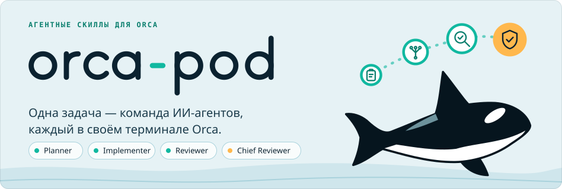

<p align="right"><a href="README.md">English</a> · <b>Русский</b></p>

<h1 align="center">
  <picture>
    <source media="(prefers-color-scheme: dark)" srcset="assets/hero-dark.ru.svg">
    
  </picture>
</h1>

<p align="center">
  <a href="#установка"></a>
  
  <a href="LICENSE"></a>
</p>

<p align="center">
  <a href="#быстрый-старт">Быстрый старт</a> ·
  <a href="#как-это-работает">Как это работает</a> ·
  <a href="#зачем">Зачем</a> ·
  <a href="#plan-blitz">Plan blitz</a> ·
  <a href="#тестовый-режим">Тестовый режим</a> ·
  <a href="#конфигурация">Конфигурация</a> ·
  <a href="#устранение-неполадок">Устранение неполадок</a>
</p>

**orca-pod** создан для [Orca](https://www.onorca.dev) — приложения, которое открывает терминалы ИИ-агентов и управляет
ими. orca-pod поручает одну задачу по программированию команде ИИ-агентов. **Planner** вместе с вами составляет
спецификацию (что строить) и план (шаги). **Implementer** выполняет план и отдаёт независимые шаги субагентам, которые
работают параллельно. Необязательные роли **Reviewer** и **Chief Reviewer** затем проверяют результат этап за этапом.
Каждая роль работает в своём терминале Orca и может использовать Claude Code, Codex или Pi со своей моделью и своим
уровнем thinking (насколько глубоко модель рассуждает, прежде чем ответить).

Подходит для задачи, которой нужен утверждённый план ещё до того, как написан первый код.

В репозитории три скилла для ИИ-агентов. Скилл — это папка с инструкциями, которую ваш агент загружает, когда вы
вводите её имя, например `/orca-pod`:

| Скилл | Что он делает для вас |
| --- | --- |
| [`orca-pod`](skills/orca-pod/README.ru.md) | Запускает задачу. Сессия, из которой вы её запустили, выступает как Coordinator: открывает по одному терминалу Orca на роль и передаёт задачу Planner. |
| [`orca-pod-setup`](skills/orca-pod-setup/README.ru.md) | Создаёт файл настроек проекта `.orca-pod/orca-pod.yaml` через форму в браузере. |
| [`plan-blitz`](skills/plan-blitz/README.ru.md) | Проводит вас по спецификации или плану перед утверждением; вопросы с вариантами ответа задаёт только там, где есть настоящий выбор. |

## Быстрый старт

**1. Установка.** Нужны [Orca](https://www.onorca.dev) (приложение, в котором работают терминалы агентов; её команда `orca` должна быть в
`PATH`), Node.js 18 или новее и git для установщика (сам проект не обязан быть Git-репозиторием); остальные
требования перечислены в разделе [Требования](#требования).

```bash
npx skills add Salesao/orca-pod -g -y -s orca-pod orca-pod-setup plan-blitz -a claude-code codex pi
```

**2. Настройка.** Откройте проект в агенте и запустите скилл настройки. Он запишет `.orca-pod/orca-pod.yaml`
через форму в браузере.

**3. Запуск задачи.** Передайте описание или путь к файлу задачи RAF (ваша сырая, неотполированная спецификация
своими словами; Planner превратит её в нормальную спецификацию и план). Путь важнее текста.

```
/orca-pod Add CSV export to the reports page
```

| | Claude Code | Codex | Pi |
| --- | --- | --- | --- |
| **Настройка** | `/orca-pod-setup` | `$orca-pod-setup` | `/skill:orca-pod-setup` |
| **Запуск** | `/orca-pod <task>` | `$orca-pod <task>` | `/skill:orca-pod <task>` |

Затем перейдите в терминал Planner в Orca. Planner напишет спецификацию и план и перед каждым утверждением задаст вам
вопросы с вариантами ответа ([plan blitz](#plan-blitz)); после вашего утверждения Implementer выполнит план.
Запуск заканчивается одним из трёх статусов: `FINAL_APPROVED` (финальное ревью одобрило результат), `SELF_VERIFIED`
(ролей ревью нет, самопроверка Implementer прошла) или `BLOCKED` (ревью не пришло к одобрению; решение за вами).
Не хотите сразу запускать на настоящей задаче? Сначала попробуйте встроенную демо-задачу: [Тестовый режим](#тестовый-режим).
Подробнее в разделах [Установка](#установка), [Первый запуск](#первый-запуск) и [Запуск задачи](#запуск-задачи).

## Как это работает

<p align="center">
  
</p>

<details>
<summary>Текстовая версия схемы</summary>

```
You ── /orca-pod <task> ──▶ Coordinator    ваша сессия: проверяет конфиг, открывает терминалы ролей,
                                │          передаёт задачу Planner и завершается
                                ▼
                            Planner        спецификация + план (волны независимых TODO) — вы их утверждаете
                                │
                                ▼
                          Implementer      выполняет каждую волну параллельными workers, собирает результат, запускает проверки
                                │ один запрос на ревью на этап
                                ▼
                            Reviewer       параллельные lanes ревью + реестр замечаний        (необязателен)
                                │ принятые этапы
                                ▼
                         Chief Reviewer    финальное ревью всего кода, FINAL_APPROVED         (необязателен)
```

</details>

<details>
<summary>Термины, которые используются в README</summary>

- **Скилл** — папка с инструкциями (файл `SKILL.md`), которую агент загружает, когда вы вводите её имя.
- **Orca** — приложение, которое открывает терминалы агентов и управляет ими; его команда — `orca`.
- **Coordinator** — сессия, из которой вы запускаете `/orca-pod`. Проверяет конфиг, открывает по одному терминалу на роль, передаёт задачу Planner и завершается.
- **Субагент** — агент, которого роль запускает для части своей работы. **Worker** — субагент, который выполняет один TODO.
- **TODO, волна, этап** — TODO это один шаг плана. Волна — группа TODO, которые не зависят друг от друга и выполняются параллельно; волны идут одна за другой. Этап — группа волн, которую проверяют вместе.
- **Lane** — одно параллельное направление проверки при ревью.
- **Файл задачи RAF** — ваша собственная черновая спецификация в том виде, в каком вы описали задачу: без структуры, можно даже надиктованная. Вы передаёте путь к ней вместо того, чтобы вводить задачу, а Planner превращает её в нормальную спецификацию и план.
- **Профиль** — именованный набор ролей, агентов, моделей и лимитов в конфиге.

</details>

## Зачем

- **Сначала план.** Ничего не реализуется, пока вы не утвердите спецификацию и план.
- **Параллельная реализация.** План разбит на волны: группы независимых TODO (шагов плана), которые меняют разные
  файлы. Implementer отдаёт каждый TODO волны отдельному субагенту worker, а сами волны выполняет одну за другой.
- **Тесты — только по вашей просьбе.** Роли не пишут, не меняют и не запускают тесты и не работают по TDD; проверки
  статические (анализатор, линтер, проверка типов). Попросите тесты в задаче или скажите об этом Planner — и они
  войдут в план.
- **Ревью по этапам.** Ревью запрашивается один раз на каждый этап и проверяется параллельными lanes. Замечания
  попадают в реестр, и блокируют только замечания `BLOCKER` и `MAJOR`. Ревью ограничено: Reviewer получает до
  3 раундов на этап, Chief Reviewer — до 2 попыток (3, если он единственная роль ревью); если за отведённые раунды
  одобрения нет, запуск заканчивается статусом `BLOCKED`, и решение за вами.
- **Глубину ревью задаёте вы**: она зависит от того, какие роли ревью включены в профиль:

  | Настроенные роли | Режим | Итоговый вердикт |
  | --- | --- | --- |
  | Reviewer и Chief Reviewer | `full` | Chief Reviewer, `FINAL_APPROVED` |
  | Только Reviewer | `reviewer` | Reviewer, `FINAL_APPROVED` |
  | Только Chief Reviewer | `chief` | Chief Reviewer, `FINAL_APPROVED` |
  | Ни одной | `self` | самопроверка Implementer, `SELF_VERIFIED` |

## Требования

Нужно в любом случае:

- **[Orca](https://www.onorca.dev)** с командой `orca` в `PATH`. Все роли работают в терминалах Orca; без неё orca-pod не работает.
- **Скилл `orca-cli`**, который Orca может установить для вас: `orca skills install --skill orca-cli`. Проверить его
  можно командой `orca skills installed`. Без скилла запуск не останавливается: роли читают справку `orca --help`.
- **Node.js 18 или новее** для скриптов скиллов (только встроенные модули, `npm install` не нужен) и `bash` для
  небольших shell-скриптов, которые создают ссылки.
- **git** для установщика: `npx skills` скачивает этот репозиторий через git, а тестовый режим держит свою
  песочницу в Git-репозитории. Сам проект Git-репозиторием быть не обязан. Без Git конфиг и отчёты лежат в папке
  проекта, а ревью читает изменённые файлы по списку от Implementer вместо диффа, поэтому изменение вне этого списка
  ревью не увидит. orca-pod никогда не выполняет `git init` в вашем проекте.
- **Скиллы superpowers** — отдельный набор скиллов для планирования: `using-superpowers`, `brainstorming` и
  `writing-plans`. Planner использует их всегда, поэтому установите их для каждого агента, на котором будет работать
  Planner.
- **Хотя бы один CLI агента** из списка ниже (программа, которую вы запускаете в терминале). Каждая роль может
  использовать своего агента, например Planner на Claude Code и Implementer на Codex.

По желанию: **скилл `plan-blitz`** из этого репозитория, он устанавливается командой ниже. Перед каждым утверждением
Planner проводит вас по спецификации и плану с его помощью; без него Planner одной строкой предупреждает вас и просит
утвердить их обычным текстом.

Для каждого агента:

| Агент | Что нужно |
| --- | --- |
| Claude Code | `claude` в `PATH` или в одной из обычных папок установки (`~/.local/bin`, `~/.claude/local`, Homebrew, nvm и другие). Субагенты из `skills/orca-pod/agents/claude/` скилл `orca-pod-setup` подключает ссылками в `~/.claude/agents/`. |
| Codex | `codex` в `PATH` или в одной из обычных папок установки. Субагентов `orca_*` регистрирует скрипт запуска, только внутри сессии каждой роли. Чтобы роли могли запускать `orca` внутри песочницы Codex, нужно правило `prefix_rule(pattern=["orca"], decision="allow")` в `~/.codex/rules/default.rules`; `orca-pod-setup` предлагает его добавить (сначала спрашивает). Правило не нужно, если профиль использует `full_access`. |
| Pi | `pi` в `PATH` или в одной из обычных папок установки, Pi 0.73.1 или новее (подходят версии и до, и после того, как в 0.74 Pi переименовал свои пакеты из `@mariozechner/*` в `@earendil-works/*`), и npm-пакет `npm:pi-subagents` версии 0.78.0. Не ставьте рядом `pi-interactive-subagents`: оба дают инструмент `subagent`, и они конфликтуют. `pi-lens` рекомендуется; им пользуются субагент `lens-checker` и самопроверка Pi. Субагентов Pi `orca-worker`, `orca-reviewer`, `orca-scout`, `orca-oracle` и `orca-evidence-auditor` подключает ссылками `orca-pod-setup`; они запускаются без ваших расширений Pi, поэтому pi-lens (и его `tsserver`) работает только в самой роли и не более чем в одном субагенте. Задайте этим субагентам модель от встроенного провайдера или провайдера из `models.json`: модель от расширения-провайдера (например, pi-claude-bridge) в них не загружается, и тогда роль запускает встроенных субагентов по одному. |

orca-pod не возобновляет прерванный запуск. Если запуск оборвался, начните новый: новый запуск — это новый вызов
скилла.

## Установка

```bash
npx skills add Salesao/orca-pod -g -y -s orca-pod orca-pod-setup plan-blitz -a claude-code codex pi
```

Команда ставит три скилла, только для Claude Code, Codex и Pi, глобально и без вопросов. Оба скилла пайплайна
обязательны: `orca-pod-setup` ищет `orca-pod` рядом с собой и отказывается стартовать без него, а `orca-pod`
вызывает `orca-pod-setup`, когда в проекте нет конфига. `plan-blitz` необязателен: без него Planner одной строкой
предупреждает вас и просит утвердить спецификацию и план обычным текстом.

Что она делает: глобальная установка (`-g`) кладёт папки скиллов в `~/.agents/skills/` (`orca-pod`,
`orca-pod-setup`, `plan-blitz`), откуда их читают Codex и Pi, и создаёт ссылки для Claude Code, например
`~/.claude/skills/orca-pod -> ../../.agents/skills/orca-pod`. Больше ничего не создаётся.

Альтернатива: установить скиллы для всех агентов, которых поддерживает CLI `skills`.

```bash
npx skills add Salesao/orca-pod -g --all
```

`--all` означает все скиллы для всех поддерживаемых агентов (сегодня это около 79 агентов), поэтому в папке скиллов
каждого агента создаются ссылки `orca-pod`, `orca-pod-setup` и `plan-blitz` — больше 100 ссылок в папках
инструментов, которыми вы можете не пользоваться. Кроме того, у нескольких агентов нет поддержки глобальной
установки: в выводе они помечены как ошибка, эти строки можно пропустить.

`npx skills add Salesao/orca-pod --list` показывает, что лежит в репозитории, ничего не устанавливая. После
установки начните новую сессию агента (в Pi — `/reload`), чтобы скиллы подхватились.

## Первый запуск

Откройте проект в агенте и запустите скилл настройки. Он запишет `.orca-pod/orca-pod.yaml` через форму в браузере.

| Агент | Команда |
| --- | --- |
| Claude Code | `/orca-pod-setup` |
| Codex | `$orca-pod-setup` |
| Pi | `/skill:orca-pod-setup` |

Этот шаг можно пропустить: `/orca-pod` сам запускает настройку, если в проекте нет конфига.

Скилл создаёт ссылки на субагентов и открывает форму — локальную страницу (её адрес дополнительно печатается строкой
`FORM URL:`, так что при необходимости его можно открыть вручную, если браузер не открылся). Когда вы нажмёте
«Сгенерировать YAML» (**Generate YAML**), агент проверит файл, сохранит его, проверит каждый профиль и предложит
правило Codex, если оно нужно роли на Codex. В форме:

1. **Для старта хватит одного профиля.** Позже добавите другие (например, экономный и тщательный); если их несколько,
   Coordinator при каждом запуске спрашивает, какой использовать.
2. **Выберите агента по умолчанию** (Claude Code, Codex или Pi). Предлагаются только агенты, CLI которых найден на
   этой машине. Для каждой роли его можно изменить.
3. **Planner и Implementer обязательны.** Добавьте **Reviewer** и/или **Chief Reviewer**, если нужно независимое
   ревью. Без них Implementer проверяет себя статическим анализом и заканчивает статусом `SELF_VERIFIED`.
4. **Выберите модель и уровень thinking для каждой роли** из списков, которые реально доступны агенту. Частый выбор:
   более сильная модель для Planner (и Chief Reviewer) и более быстрая для Implementer.
5. **Включите субагентов для Implementer** (переключатель «Субагенты» в карточке роли, `use_subagents`; в английской
   форме — «Subagents»). По умолчанию переключатель выключен у каждой роли, а когда он выключен, Implementer
   выполняет волны по очереди, а не параллельно. Включите его и для других ролей, которым это полезно (scouts у
   Planner, lanes у Reviewer). Значение «Субагентов одновременно» (**Concurrent subagents**) оставьте равным 6.
6. **Не включайте «Полные права»** (**Full access**), пока не прочли предупреждение ниже.
7. Нажмите «Сгенерировать YAML». Форма передаст результат агенту, который проверит и сохранит файл; затем скилл
   добавит `.orca-pod/` в ваш `.gitignore`, если в проекте он уже есть (сам он его не создаёт).

## Запуск задачи

| Агент | Команда |
| --- | --- |
| Claude Code | `/orca-pod <task description or RAF path>` |
| Codex | `$orca-pod <task description or RAF path>` |
| Pi | `/skill:orca-pod <task description or RAF path>` |

```
/orca-pod Add CSV export to the reports page
/orca-pod docs/tasks/csv-export.md
```

На вход подаётся путь к файлу задачи RAF (ваша сырая спецификация своими словами; путь важнее текста) или обычное
текстовое описание. Что происходит дальше:

1. Coordinator проверяет конфиг, спрашивает, какой профиль использовать (только если их несколько) и какие
   дополнительные скиллы нужны каждой роли, открывает терминал для каждой настроенной роли, отправляет задачу
   Planner и завершается.
2. Перейдите в терминал Planner в Orca. Planner изучает код, пишет спецификацию и план и перед каждым утверждением
   проводит [plan blitz](#plan-blitz): короткие раунды вопросов с вариантами ответа. Отвечайте на них там же.
3. После утверждения Implementer продолжает работу: выполняет волны и отправляет этапы на ревью. Запуск
   заканчивается итоговым статусом: `FINAL_APPROVED`, `SELF_VERIFIED` или `BLOCKED` (ревью не пришло к одобрению;
   решение за вами).
4. Отчёты ревью и самопроверки записываются в `<project root>/.orca-pod/reports/<planVersion>/`.

Скилл никогда не создаёт worktree (отдельные рабочие копии репозитория), а команды, которые меняют git-репозиторий
(commit, push, stash, reset, branch), выполняются только с вашего отдельного разрешения.

## Plan blitz

Спецификация или план — длинные и плотные документы. Перед утверждением Planner проводит вас по документу скиллом
`plan-blitz`: сначала короткий обзор того, что будет происходить (для плана с картой его задач), потом вопросы только
там, где есть настоящий выбор. К каждому вопросу прилагается карточка: ситуация, предложение, его цена и, если есть,
настоящая альтернатива. Первый вариант — предложение, с пометкой «(предложено)», а каждый вариант говорит, что будет и
чего это стоит. Вопрос, на который вы ответили, повторно не задаётся, если только поздний ответ не изменил его суть; ваши изменения вносятся в документ, и следующий раунд спрашивает только о том, что
ещё открыто, что добавилось или изменилось. Последний шаг — само утверждение: перед ним Planner перечисляет решения,
которые принял сам без вопроса, а утверждение предлагает «Утвердить», «Сначала прочитать целиком» и, если вопросы
были, «Вернуться к вопросу».

Blitz начинается со строки с путём к документу: его можно открыть и сверить с ним любую карточку, а при утверждении
путь показывается снова. После каждого раунда в документ добавляется строка журнала блица, поэтому видно, по какой
версии документа шёл каждый раунд. Если настоящего выбора нет, blitz пишет об этом одной строкой перед утверждением.

Вы можете запустить `plan-blitz` и сами на любой спецификации или плане, например после superpowers brainstorming или
writing-plans:

| Агент | Команда |
| --- | --- |
| Claude Code | `/plan-blitz <path to the spec or plan>` |
| Codex | `$plan-blitz <path>` |
| Pi | `/skill:plan-blitz <path>` |

Вопросы задаются в собственном окне вопросов каждого агента:

| Агент | Окно вопросов | Примечания |
| --- | --- | --- |
| Claude Code | `AskUserQuestion` | Встроено. |
| Codex | `request_user_input` | В режиме по умолчанию инструмент доступен только при включённом флаге функции. orca-pod включает его для Planner на Codex; при ручном запуске запустите Codex командой `codex --enable default_mode_request_user_input`. Окно закрывается само примерно через две минуты (тогда blitz спрашивает ещё раз); утверждение там идёт пронумерованным списком в тексте, а не окном. |
| Pi | `orca_pod_ask` | Приходит из расширения, на которое создаёт ссылку `orca-pod-setup`; после настройки выполните `/reload` в Pi. |

Без такого окна blitz спрашивает пронумерованным списком в тексте.
Подробности: [skills/plan-blitz/README.ru.md](skills/plan-blitz/README.ru.md) и [SKILL.md](skills/plan-blitz/SKILL.md).

## Тестовый режим

Прежде чем запускать orca-pod на настоящей задаче, пройдите весь процесс на встроенной демо-задаче:

```
/orca-pod test                запустить демо-задачу в песочнице ~/orca-pod-test (ваш проект не затрагивается)
/orca-pod test check          проверить результат: PASS / WARN / FAIL по каждому модулю и критерию
/orca-pod test reset          сбросить песочницу
```

В Codex используйте `$orca-pod test`, в Pi — `/skill:orca-pod test`. Если вы запускали не на профиле по умолчанию,
добавьте `--profile <name>` к `test check`. Единственное изменение в git — базовый коммит внутри песочницы.
Ожидаемый сценарий тестового запуска описан в
[skills/orca-pod/assets/test/EXPECTED.md](skills/orca-pod/assets/test/EXPECTED.md). В Codex песочница лежит вне
рабочей папки, поэтому Codex запросит повышенные права на запись туда, либо запустите Codex с флагом
`--add-dir ~/orca-pod-test`.

## Язык

Поле `language` в корне `orca-pod.yaml` задаёт язык, на котором роли общаются с вами: сообщения в терминале,
спецификация и план, текст отчётов, итоговый отчёт.

- `auto` (по умолчанию) — это язык вашего собственного текста: описание задачи, написанный вами файл задачи и ваши
  другие сообщения в сессии, например ответ на вопрос о профиле. Демо-задача `/orca-pod test` вашим текстом не
  считается, поэтому и там язык определяют ваши собственные сообщения. Только если вы не написали вообще ничего,
  например при `/orca-pod test` без текста, язык — английский.
- Явный тег, например `en`, `ru` или `pt-BR`, имеет приоритет над `auto`, даже если вы пишете на другом языке.

Служебные строки и токены остаются английскими при любом выборе: строки промптов `ROLE:` и `LANGUAGE:`, токены вроде
`REVIEW_REQUEST` и `APPROVED` и метки отчётов вроде `Verdict:`. Сама форма настройки двуязычная (английский
и русский) с переключателем EN/RU.

## Полный доступ

> [!WARNING]
> С `full_access: true` роли Codex и Claude Code пропускают запросы разрешений и работают без песочницы, поэтому
> роль может изменить что угодно на машине. Роли Codex стартуют с `--dangerously-bypass-approvals-and-sandbox`,
> а роли Claude Code — с `--dangerously-skip-permissions`. Роли Pi не меняются. Первый вопрос о доверии или
> подтверждение обхода всё равно может появиться в терминале роли; см. [Устранение неполадок](#устранение-неполадок).

По умолчанию он выключен и доступен только как переключатель профиля «Полные права» (**Full access**) в форме настройки:
ни один скилл и ни одна роль сами его не включают и не предлагают как способ обойти отказ. Если его включает конфиг,
который написали не вы (файл отслеживается git или его только что перенесли), Coordinator просит подтверждения,
прежде чем запускать какие-либо терминалы. Используйте его только на машине и в проекте, которым вы доверяете,
лучше в одноразовом worktree или виртуальной машине. Без него роли Codex и Claude Code запрашивают разрешения в своих
терминалах; отвечайте там.

## Конфигурация

Один файл на репозиторий: `<main checkout>/.orca-pod/orca-pod.yaml` (в основной рабочей копии). У дополнительного
worktree может быть свой файл в его собственной `.orca-pod/`, и он имеет приоритет. Без Git файл лежит в
`<project folder>/.orca-pod/orca-pod.yaml`: в папке, где вы запускаете агента, или в ближайшей родительской папке,
где уже есть `.orca-pod/`. Папка добавляется в `.gitignore`,
если в проекте он есть (настройка никогда не создаёт `.gitignore`); если его нет, добавьте `.orca-pod/` вручную до
коммита. Старые варианты структуры — каталог `.orca-pipeline/` (с `orca-pipeline.yaml` и `reports/`) и
`orca-pipeline.yaml` в корне проекта — переносятся в `.orca-pod/` автоматически, и о каждом перенесённом пути вы
получите сообщение.

Редактируйте файл через `orca-pod-setup`; файл, написанный вручную, проверяется строго (неизвестный ключ останавливает
запуск до открытия первого терминала). Минимальный пример:

```yaml
active_profile: default
language: auto

profiles:
  default:
    default_provider: claude-code
    max_subagents: 6
    roles:
      planner:
        model: opus
        thinking: high
        use_subagents: true
        subagents:
          scout:
            model: inherit
            thinking: low
      implementer:
        model: sonnet
        thinking: medium
        use_subagents: true
        subagents:
          worker:
            model: inherit
            thinking: inherit
      reviewer:
        model: opus
        thinking: high
```

| Ключ | Значение |
| --- | --- |
| `active_profile` | Профиль по умолчанию, предлагается первым при запуске. |
| `default_provider` | Агент (в конфиге он называется provider). В корне файла: запасной вариант для профилей, где агент не задан. В профиле: агент для ролей без `provider`. Одно из значений: `pi`, `claude-code`, `codex`. |
| `language` | `auto` (по умолчанию) или языковой тег, например `en`, `ru`, `pt-BR`. |
| `profiles` | Именованные профили; у каждого свои роли, агенты, модели и лимиты. |
| `max_subagents` | В профиле: сколько субагентов одна роль запускает одновременно, целое число 1–100, по умолчанию 6. |
| `full_access` | В профиле: см. предупреждение выше; `false`, если ключа нет. |
| `roles` | `planner` и `implementer` обязательны; `reviewer` и `chief_reviewer` необязательны и определяют режим ревью. |
| `provider`, `model`, `thinking` | В роли: агент, доступная этому агенту модель и поддерживаемый им уровень thinking. |
| `use_subagents`, `subagents` | В роли: отдавать работу субагентам (`true`) или работать без них, а также модель и thinking каждого субагента; `inherit` берёт то же значение, что у самой роли. |

Каждое поле описано в [справочнике settings.md](skills/orca-pod-setup/references/settings.md) (на английском).
Чтобы проверить конфиг, ничего не запуская, выполните это из корня проекта:

```bash
node ~/.agents/skills/orca-pod/scripts/launch-provider.mjs --profiles
```

## Устранение неполадок

- **Терминал роли застрял на вопросе о доверии.** Codex и Claude Code спрашивают, доверять ли папке, когда роль
  впервые запускается в ней, а Codex спрашивает даже при `full_access`. Coordinator сообщает о заблокированном
  терминале; ответьте на вопрос в терминале этой роли, и запуск продолжится.
- **Claude Code показывает подтверждение «Bypass Permissions».** При `full_access: true` роли Claude Code стартуют
  в режиме обхода разрешений, и Claude Code просит подтвердить его в терминале роли. Подтвердите там или выключите
  `full_access` в `orca-pod-setup`.
- **Codex падает с `runtime_access_denied`, когда роль запускает `orca`.** В Codex нет нужного правила. Запустите
  `orca-pod-setup` ещё раз и ответьте «да» на вопрос о правиле, либо добавьте
  `prefix_rule(pattern=["orca"], decision="allow")` в `~/.codex/rules/default.rules` сами, либо подтвердите
  повторный запрос с повышенными правами, который задаёт Codex. Не обходите песочницу никаким другим способом.
- **`orca-pod skill not found`.** Установлен только один из двух скиллов. Установите оба (см. раздел «Установка»).
- **Форма настройки не предлагает моделей для агента.** Причину называет строка `CATALOG` этого агента в выводе
  настройки. `not found`: установите CLI агента или добавьте его папку в `PATH`; настройка ищет и в обычных папках
  установки, а `ORCA_POD_BIN_DIRS` заменяет их список. `no write access (sandbox?)`: в Codex запустите настройку ещё
  раз и разрешите повышенные права, которые она запросит; Pi пишет файлы блокировки в `~/.pi/agent`, даже чтобы
  просто перечислить модели.
- **Pi пишет `Cannot find module '@earendil-works/pi-ai'`.** Расширению из orca-pod 0.1.0 нужен был Pi 0.74 или
  новее. Установите скиллы заново (см. раздел «Установка») и выполните `/reload` в Pi или обновите Pi командой
  `pi update --self`.
- **`PIPELINE CONFIG REJECTED`.** Сообщение называет файл и точное поле. Исправьте конфиг в `orca-pod-setup`.
- **В Pi нет инструмента `orca_pod_setup` или `orca_pod_ask`.** Выполните `/reload` в Pi после того, как `orca-pod-setup`
  создаст ссылку на расширение; без `orca_pod_ask` blitz спрашивает пронумерованным списком в тексте.
- **Много процессов `tsserver` в Pi.** Каждый субагент, который загружает ваши расширения Pi, запускает собственный
  `tsserver` от pi-lens. Запустите `orca-pod-setup` ещё раз, чтобы он создал ссылки на субагентов `orca-*` (ищите
  строки `LINK`); `SKIP` означает, что файл с таким именем уже есть в `~/.pi/agent/agents/`.
- **Два инструмента `subagent` в Pi.** Удалите `pi-interactive-subagents`; оставьте `npm:pi-subagents` 0.78.0.
- **Запуск прервался.** Начните новый вызов; запуски не возобновляются.

## Удаление

```bash
npx skills remove orca-pod orca-pod-setup plan-blitz -g -y
```

Команда удаляет три скилла и их ссылки в папках всех агентов, в том числе после установки с `--all`. Если CLI не
запускается, удалите ссылки вручную: сначала выведите их список, потом удалите именно их.

```bash
# 1. вывести список ссылок (ничего не удаляется)
find "$HOME" -maxdepth 5 -type l \( -name 'orca-pod*' -o -name plan-blitz \) \( -lname '*/.agents/skills/orca-pod*' -o -lname '*/.agents/skills/plan-blitz' \) -print
# 2. проверив список, удалить их
find "$HOME" -maxdepth 5 -type l \( -name 'orca-pod*' -o -name plan-blitz \) \( -lname '*/.agents/skills/orca-pod*' -o -lname '*/.agents/skills/plan-blitz' \) -delete
# 3. удалить папки скиллов
rm -r ~/.agents/skills/orca-pod ~/.agents/skills/orca-pod-setup ~/.agents/skills/plan-blitz
```

Настройка также создала ссылки на субагентов и на расширение Pi, а `npx skills remove` их не трогает. Удалите их
так же (сообщения «нет такого файла» безвредны):

```bash
find ~/.claude/agents ~/.pi/agent/agents -maxdepth 1 -type l -lname '*/skills/orca-pod/agents/*' -print
find ~/.claude/agents ~/.pi/agent/agents -maxdepth 1 -type l -lname '*/skills/orca-pod/agents/*' -delete
[ -L ~/.pi/agent/extensions/orca-pod-setup ] && rm ~/.pi/agent/extensions/orca-pod-setup
```

Если вы удалили старую версию скиллов и теперь часть ссылок на субагентов стала битой, запустите `orca-pod-setup`
ещё раз: его скрипт `link-agents.sh` выводит `RELINK` и направляет каждую битую ссылку на текущий скилл. Рабочая
ссылка на субагента (её использует другая установленная версия) остаётся нетронутой и выводится как `SKIP`.

В ваших проектах остаётся папка `.orca-pod/` (конфиг и отчёты); удалите её, если она не нужна. Правило Codex
в `~/.codex/rules/default.rules` остаётся, пока вы не удалите эту строку.

## Дополнительная документация

README скиллов переведены на русский; файлы SKILL.md и справочники остаются на английском.

- [skills/orca-pod/README.ru.md](skills/orca-pod/README.ru.md) и [SKILL.md](skills/orca-pod/SKILL.md): пайплайн, его
  роли, режимы ревью и полный рабочий процесс.
- [skills/orca-pod-setup/README.ru.md](skills/orca-pod-setup/README.ru.md) и [SKILL.md](skills/orca-pod-setup/SKILL.md):
  форма настройки и то, что она записывает.
- [skills/plan-blitz/README.ru.md](skills/plan-blitz/README.ru.md) и [SKILL.md](skills/plan-blitz/SKILL.md): раунды
  вопросов перед утверждением.

## Разработка

`npm test` запускает все тесты (Node 20.19 или новее, без зависимостей; сами скрипты скиллов работают и на Node 18).
CI запускает ту же команду на Node 20.

## Лицензия

MIT, см. [LICENSE](LICENSE).
