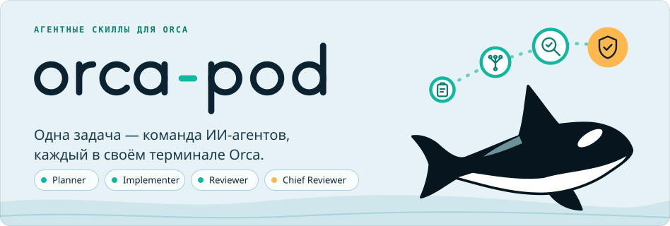

<p align="right"><a href="README.md">English</a> · <b>Русский</b></p>

<h1 align="center">
  <picture>
    <source media="(prefers-color-scheme: dark)" srcset="assets/hero-dark.ru.svg">
    
  </picture>
</h1>

<p align="center">
  <a href="#установка"></a>
  
  <a href="LICENSE"></a>
</p>

<p align="center">
  <a href="#быстрый-старт">Быстрый старт</a> ·
  <a href="#как-это-работает">Как это работает</a> ·
  <a href="#зачем">Зачем</a> ·
  <a href="#помощники">Помощники</a> ·
  <a href="#окно-вопросов-pi">Окно вопросов Pi</a> ·
  <a href="#plan-blitz">Plan blitz</a> ·
  <a href="#тестовый-режим">Тестовый режим</a> ·
  <a href="#конфигурация">Конфигурация</a> ·
  <a href="#устранение-неполадок">Устранение неполадок</a>
</p>

**orca-pod** создан для [Orca](https://www.onorca.dev) — приложения, которое открывает терминалы ИИ-агентов и управляет
ими. orca-pod поручает одну задачу по программированию команде ИИ-агентов. **Planner** вместе с вами составляет
спецификацию (что строить) и план (шаги). **Implementer** выполняет план и отдаёт независимые шаги субагентам, которые
работают параллельно. Необязательные роли **Reviewer** и **Chief Reviewer** затем проверяют результат этап за этапом.
Каждая роль работает в своём терминале Orca и может использовать Claude Code, Codex, Pi, Qoder или OMP со своей моделью и своим
уровнем thinking (насколько глубоко модель рассуждает, прежде чем ответить).

Подходит для задачи, которой нужен утверждённый план ещё до того, как написан первый код.

В форме настройки можно создать **до пяти профилей**, выбрать **до трёх предустановленных специализаций на роль**
и добавить **любое количество своих помощников**. Роль помощника и его инструкции задаются прямо в форме вместе
с моделью и thinking и сохраняются в проекте. Параллельность задаётся отдельно: **6 по умолчанию, диапазон 1–100**.

В репозитории три скилла для ИИ-агентов. Скилл — это папка с инструкциями, которую ваш агент загружает, когда вы
вводите её имя, например `/orca-pod`:

| Скилл | Что он делает для вас |
| --- | --- |
| [`orca-pod`](skills/orca-pod/README.ru.md) | Запускает задачу. Сессия, из которой вы её запустили, выступает как Coordinator: открывает по одному терминалу Orca на роль и передаёт задачу Planner. |
| [`orca-pod-setup`](skills/orca-pod-setup/README.ru.md) | Создаёт файл настроек проекта `.orca-pod/orca-pod.yaml` через форму в браузере. |
| [`plan-blitz`](skills/plan-blitz/README.ru.md) | Проводит вас по спецификации или плану перед утверждением; вопросы с вариантами ответа задаёт только там, где есть настоящий выбор. |

## Быстрый старт

**1. Установка.** Нужны [Orca](https://www.onorca.dev) (приложение, в котором работают терминалы агентов; её команда `orca` должна быть в
`PATH`), Node.js 18 или новее и git для установщика (сам проект не обязан быть Git-репозиторием); остальные
требования перечислены в разделе [Требования](#требования).

```bash
npx skills add Salesao/orca-pod -g -y -s orca-pod orca-pod-setup plan-blitz -a claude-code codex pi
```

**2. Настройка.** Откройте проект в агенте и запустите скилл настройки. Он запишет `.orca-pod/orca-pod.yaml`
через форму в браузере.

**3. Запуск задачи.** Передайте описание или путь к файлу задачи RAF (ваша сырая, неотполированная спецификация
своими словами; Planner превратит её в нормальную спецификацию и план). Путь важнее текста.

```
/orca-pod Add CSV export to the reports page
```

| | Claude Code | Codex | Pi |
| --- | --- | --- | --- |
| **Настройка** | `/orca-pod-setup` | `$orca-pod-setup` | `/skill:orca-pod-setup` |
| **Запуск** | `/orca-pod <task>` | `$orca-pod <task>` | `/skill:orca-pod <task>` |

Затем перейдите в терминал Planner в Orca. Planner напишет спецификацию и план и перед каждым утверждением задаст вам
вопросы с вариантами ответа ([plan blitz](#plan-blitz)); после вашего утверждения Implementer выполнит план.
Запуск заканчивается одним из четырёх статусов: `FINAL_APPROVED` (финальное ревью одобрило результат), `SELF_VERIFIED`
(ролей ревью нет, самопроверка Implementer прошла), `COMPLETED_UNVERIFIED` (обязательные проверки недоступны после
повтора и запасного варианта) или `BLOCKED` (ревью не пришло к одобрению; решение за вами).
Не хотите сразу запускать на настоящей задаче? Сначала попробуйте встроенную демо-задачу: [Тестовый режим](#тестовый-режим).
Подробнее в разделах [Установка](#установка), [Первый запуск](#первый-запуск) и [Запуск задачи](#запуск-задачи).

## Как это работает

<p align="center">
  
</p>

<details>
<summary>Текстовая версия схемы</summary>

```
You ── /orca-pod <task> ──▶ Coordinator    ваша сессия: проверяет конфиг, открывает терминалы ролей,
                                │          передаёт задачу Planner и завершается
                                ▼
                            Planner        спецификация + план (волны независимых TODO) — вы их утверждаете
                                │
                                ▼
                          Implementer      выполняет каждую волну параллельными workers, собирает результат, запускает проверки
                                │ один запрос на ревью на этап
                                ▼
                            Reviewer       параллельные lanes ревью + реестр замечаний        (необязателен)
                                │ принятые этапы
                                ▼
                         Chief Reviewer    финальное ревью всего кода, FINAL_APPROVED         (необязателен)
```

</details>

<details>
<summary>Термины, которые используются в README</summary>

- **Скилл** — папка с инструкциями (файл `SKILL.md`), которую агент загружает, когда вы вводите её имя.
- **Orca** — приложение, которое открывает терминалы агентов и управляет ими; его команда — `orca`.
- **Coordinator** — сессия, из которой вы запускаете `/orca-pod`. Проверяет конфиг, открывает по одному терминалу на роль, передаёт задачу Planner и завершается.
- **Субагент** — агент, которого роль запускает для части своей работы. **Worker** — субагент, который выполняет один TODO.
- **TODO, волна, этап** — TODO это один шаг плана. Волна — группа TODO, которые не зависят друг от друга и выполняются параллельно; волны идут одна за другой. Этап — группа волн, которую проверяют вместе.
- **Lane** — одно параллельное направление проверки при ревью.
- **Файл задачи RAF** — ваша собственная черновая спецификация в том виде, в каком вы описали задачу: без структуры, можно даже надиктованная. Вы передаёте путь к ней вместо того, чтобы вводить задачу, а Planner превращает её в нормальную спецификацию и план.
- **Профиль** — именованный набор ролей, агентов, моделей и лимитов в конфиге.

</details>

## Зачем

- **Сначала план.** Ничего не реализуется, пока вы не утвердите спецификацию и план.
- **Параллельная реализация.** План разбит на волны: группы независимых TODO (шагов плана), которые меняют разные
  файлы. При включённом делегировании Implementer отдаёт независимые TODO выбранным workers, а сами волны выполняет
  одну за другой. При выключенном делегировании роль выполняет работу сама.
- **Тесты — только по вашей просьбе.** Роли не пишут, не меняют и не запускают тесты и не работают по TDD; проверки
  статические (анализатор, линтер, проверка типов). Попросите тесты в задаче или скажите об этом Planner — и они
  войдут в план.
- **Ревью по этапам.** Ревью запрашивается один раз на каждый этап; при включённом делегировании используются параллельные lanes. Замечания
  попадают в реестр, и блокируют только замечания `BLOCKER` и `MAJOR`. Ревью ограничено: Reviewer получает до
  3 раундов на этап, Chief Reviewer — до 2 попыток (3, если он единственная роль ревью); если за отведённые раунды
  одобрения нет, запуск заканчивается статусом `BLOCKED`, и решение за вами.
- **Проверки следуют за изменениями.** Во время работы проверяются изменённые файлы. На последнем этапе выполняется
  один накопительный проход по всем изменениям. После исправлений проверяются сами исправления и затронутые
  потребители; Chief проверяет собственные поздние исправления. Если обязательные проверки недоступны после
  повтора и запасного варианта, работа завершена и блокирующих дефектов нет, итог — `COMPLETED_UNVERIFIED`.
- **Глубину ревью задаёте вы**: она зависит от того, какие роли ревью включены в профиль:

  | Настроенные роли | Режим | Итоговый вердикт |
  | --- | --- | --- |
  | Reviewer и Chief Reviewer | `full` | Chief Reviewer, `FINAL_APPROVED` |
  | Только Reviewer | `reviewer` | Reviewer, `FINAL_APPROVED` |
  | Только Chief Reviewer | `chief` | Chief Reviewer, `FINAL_APPROVED` |
  | Ни одной | `self` | самопроверка Implementer, `SELF_VERIFIED` |

## Требования

Нужно в любом случае:

- **[Orca](https://www.onorca.dev)** с командой `orca` в `PATH`. Все роли работают в терминалах Orca; без неё orca-pod не работает.
- **Скилл `orca-cli`**, который Orca может установить для вас: `orca skills install --skill orca-cli`. Проверить его
  можно командой `orca skills installed`. Без скилла запуск не останавливается: роли читают справку `orca --help`.
- **Node.js 18 или новее** для скриптов скиллов (только встроенные модули, `npm install` не нужен) и `bash` для
  небольших shell-скриптов, которые создают ссылки.
- **git** для установщика: `npx skills` скачивает этот репозиторий через git, а тестовый режим держит свою
  песочницу в Git-репозитории. Сам проект Git-репозиторием быть не обязан. Без Git конфиг и отчёты лежат в папке
  проекта, а ревью читает изменённые файлы по списку от Implementer вместо диффа, поэтому изменение вне этого списка
  ревью не увидит. orca-pod никогда не выполняет `git init` в вашем проекте.
- **Скиллы superpowers** — отдельный набор скиллов для планирования: `using-superpowers`, `brainstorming` и
  `writing-plans`. Planner использует их всегда, поэтому установите их для каждого агента, на котором будет работать
  Planner.
- **Хотя бы один CLI агента** из списка ниже (программа, которую вы запускаете в терминале). Каждая роль может
  использовать своего агента, например Planner на Claude Code и Implementer на Codex.

По желанию: **скилл `plan-blitz`** из этого репозитория, он устанавливается командой ниже. Перед каждым утверждением
Planner проводит вас по спецификации и плану с его помощью; без него Planner одной строкой предупреждает вас и просит
утвердить их обычным текстом.

Для каждого агента:

| Агент | Что нужно |
| --- | --- |
| Claude Code | `claude` в `PATH` или в одной из обычных папок установки (`~/.local/bin`, `~/.claude/local`, Homebrew, nvm и другие). Субагенты из `skills/orca-pod/agents/claude/` скилл `orca-pod-setup` подключает ссылками в `~/.claude/agents/`. |
| Codex | `codex` в `PATH` или в одной из обычных папок установки. Помощники `orca_*` регистрируются на время сессии роли. Для прямых запусков в песочнице настройка предлагает правило `prefix_rule(pattern=["orca"], decision="allow")` в `~/.codex/rules/default.rules`. Координатор запрашивает Full Access. Для Planner нужны проверенные средства Plan mode и сохранения документов, описанные ниже. |
| Pi | Проверено с Pi 1.4.0 и pi-subagents 0.81.0. Роль сохраняет Lens для своих проверок, а помощники наследуют зарегистрированных провайдеров моделей без фоновых расширений. При несовместимости роль работает сама. |
| Qoder | `qodercli` в `PATH` или в обычной папке установки; в YAML — `provider: qoder`. Каталог читается через `qodercli --list-models`, thinking — `default`. Выбранные определения помощников регистрируются на время сессии. |
| OMP | `omp` в `PATH` или в обычной папке установки; в YAML — `provider: omp`. Модели и уровни thinking берутся из `omp models --json`. Настройка подключает штатных агентов, политика сессии управляет нативным делегированием. |

Установленные Qoder и OMP доступны и при неполном каталоге: где позволяют проверенные возможности CLI, форма
предлагает **Ввести ID модели**. См. [проверенные версии и ограничения](docs/compatibility/2026-11-11-provider-capabilities.md).

orca-pod не возобновляет прерванный запуск. Если запуск оборвался, начните новый: новый запуск — это новый вызов
скилла.

## Установка

```bash
npx skills add Salesao/orca-pod -g -y -s orca-pod orca-pod-setup plan-blitz -a claude-code codex pi
```

Команда ставит три скилла, только для Claude Code, Codex и Pi, глобально и без вопросов. Оба скилла пайплайна
обязательны: `orca-pod-setup` ищет `orca-pod` рядом с собой и отказывается стартовать без него, а `orca-pod`
вызывает `orca-pod-setup`, когда в проекте нет конфига. `plan-blitz` необязателен: без него Planner одной строкой
предупреждает вас и просит утвердить спецификацию и план обычным текстом.

Координатор может работать в любом из этих трёх хостов и запускать роли во всех пяти установленных провайдерах,
включая Qoder и OMP. До запуска ролей войдите в каждый выбранный CLI; обнаружение каталога проверяет метаданные моделей.

Что она делает: глобальная установка (`-g`) кладёт папки скиллов в `~/.agents/skills/` (`orca-pod`,
`orca-pod-setup`, `plan-blitz`), откуда их читают Codex и Pi, и создаёт ссылки для Claude Code, например
`~/.claude/skills/orca-pod -> ../../.agents/skills/orca-pod`. Больше ничего не создаётся.

Альтернатива: установить скиллы для всех агентов, которых поддерживает CLI `skills`.

```bash
npx skills add Salesao/orca-pod -g --all
```

`--all` означает все скиллы для всех поддерживаемых агентов (сегодня это около 79 агентов), поэтому в папке скиллов
каждого агента создаются ссылки `orca-pod`, `orca-pod-setup` и `plan-blitz` — больше 100 ссылок в папках
инструментов, которыми вы можете не пользоваться. Кроме того, у нескольких агентов нет поддержки глобальной
установки: в выводе они помечены как ошибка, эти строки можно пропустить.

`npx skills add Salesao/orca-pod --list` показывает, что лежит в репозитории, ничего не устанавливая. После
установки начните новую сессию агента (в Pi — `/reload`), чтобы скиллы подхватились.

## Окно вопросов Pi

**pi-task** — самостоятельный пакет Pi, который предоставляет инструмент вопросов **`pi_task`**. Установите его
из локальной копии отдельного репозитория, затем перезагрузите расширения или перезапустите Pi:

```bash
pi install /absolute/path/to/pi-task
```

Установщик скиллов этот пакет не устанавливает. Расширение настройки предоставляет `orca_pod_setup` для формы
в браузере, а `pi-task` отвечает за окно вопросов plan-blitz. Пакет можно использовать и отдельно от orca-pod.
Стрелки и Enter выбирают вариант, **Type something.** позволяет написать свой ответ. Для нескольких вопросов
используйте вкладки и **Submit**. Esc сначала выходит из редактора текста, а затем отменяет окно вопросов.
Уже установленный старый `orca_pod_ask` остаётся запасным вариантом, если `pi_task` недоступен.

## Первый запуск

Откройте проект в агенте и запустите скилл настройки. Он запишет `.orca-pod/orca-pod.yaml` через форму в браузере.

| Агент | Команда |
| --- | --- |
| Claude Code | `/orca-pod-setup` |
| Codex | `$orca-pod-setup` |
| Pi | `/skill:orca-pod-setup` |

Этот шаг можно пропустить: `/orca-pod` сам запускает настройку, если в проекте нет конфига.

Скилл создаёт ссылки на субагентов и открывает форму — локальную страницу (её адрес дополнительно печатается строкой
`FORM URL:`, так что при необходимости его можно открыть вручную, если браузер не открылся). Когда вы нажмёте
«Сгенерировать YAML» (**Generate YAML**), агент проверит файл, сохранит его, проверит каждый профиль и предложит
правило Codex, если оно нужно роли на Codex. В форме:

1. **Создайте до пяти профилей.** Для старта хватит одного; позже можно добавить экономный или тщательный вариант.
   Новый профиль копирует текущий. Если профилей несколько, Coordinator при каждом запуске спрашивает, какой использовать.
2. **Выберите агента по умолчанию** (Claude Code, Codex, Pi, Qoder или OMP). Предлагаются только агенты, CLI которых найден на
   этой машине. Для каждой роли его можно изменить.
3. **Planner и Implementer обязательны.** Добавьте **Reviewer** и/или **Chief Reviewer**, если нужно независимое
   ревью. Без них Implementer проверяет себя статическим анализом и заканчивает статусом `SELF_VERIFIED`.
4. **Выберите модель и уровень thinking для каждой роли** из списков, которые реально доступны агенту. Частый выбор:
   более сильная модель для Planner (и Chief Reviewer) и более быстрая для Implementer.
5. **Выберите помощников для каждой роли.** Включите `use_subagents` для Implementer и других ролей, которым нужно
   делегирование; у новых ролей переключатель выключен. Выберите до трёх предустановленных специализаций и добавьте
   сколько нужно своих помощников. При выключенном переключателе роль работает сама. «Субагентов одновременно» —
   отдельная настройка: 6 по умолчанию, диапазон 1–100. См. [Помощники](#помощники).
6. **Проверьте режим доступа.** Координатор запрашивает поддерживаемый YOLO, а «Полные права» (**Full access**)
   управляют прямыми запусками без координатора. См. [Полный доступ](#полный-доступ).
7. Нажмите «Сгенерировать YAML». Форма передаст результат агенту, который проверит и сохранит файл; затем скилл
   добавит `.orca-pod/` в ваш `.gitignore`, если в проекте он уже есть (сам он его не создаёт).

## Помощники

У каждой основной роли свой набор помощников:

| Настройка | Ограничение |
| --- | --- |
| Предустановленные специализации | До 3 на роль |
| Свои помощники | Количество не ограничено |
| Одновременно работающие экземпляры | `max_subagents`: 6 по умолчанию, диапазон 1–100 на роль |

Предустановленные наборы:

| Роль | По умолчанию, если явный набор не сохранён |
| --- | --- |
| Planner | `scout`, `researcher`, `oracle` |
| Implementer | `worker`, `scout`, `verifier` (`verifier` только в режиме `self`) |
| Reviewer | `reviewer`, `scout` |
| Chief Reviewer | `reviewer`, `evidence-auditor`, `scout` |

Чтобы определить своего помощника в форме настройки:

1. Нажмите **Добавить своего помощника** в карточке роли. Кнопка доступна и после выбора трёх предустановленных помощников.
2. Укажите уникальное для этой роли имя, **Описание роли** в одну строку и многострочные **Инструкции**.
3. Выберите модель и thinking или `inherit`, чтобы использовать настройки основной роли, затем сгенерируйте и сохраните YAML.

Определение хранится в настройках проекта и сохраняется при повторном открытии формы, копировании профиля и
выключении делегирования. Оно регистрируется на время запуска в любом из пяти провайдеров; отдельный файл агента
не нужен. Помощники планирования и ревью получают инструменты чтения; дальнейшее делегирование им запрещено.

Чтобы подключить установленного нативного помощника по имени, выключите **Задать роль помощника в этой форме**.
Внешние имена и имена с собственными описанием и инструкциями не занимают места предустановленных помощников.
Явный набор заменяет стандартный. При выключенном делегировании или несовместимом помощнике основная роль
выполняет работу сама; если хост способен ограничить действие только инструкцией, скрипт запуска сообщает об этом.

## Запуск задачи

| Агент | Команда |
| --- | --- |
| Claude Code | `/orca-pod <task description or RAF path>` |
| Codex | `$orca-pod <task description or RAF path>` |
| Pi | `/skill:orca-pod <task description or RAF path>` |

```
/orca-pod Add CSV export to the reports page
/orca-pod docs/tasks/csv-export.md
```

На вход подаётся путь к файлу задачи RAF (ваша сырая спецификация своими словами; путь важнее текста) или обычное
текстовое описание. Что происходит дальше:

1. Coordinator проверяет конфиг, спрашивает, какой профиль использовать (только если их несколько) и какие
   дополнительные скиллы нужны каждой роли, открывает терминал для каждой настроенной роли, отправляет задачу
   Planner и завершается.
2. Перейдите в терминал Planner в Orca. Planner изучает код, пишет спецификацию и план и перед каждым утверждением
   проводит [plan blitz](#plan-blitz): короткие раунды вопросов с вариантами ответа. Отвечайте на них там же.
3. После утверждения Implementer продолжает работу: выполняет волны и отправляет этапы на ревью. Запуск
   заканчивается итоговым статусом: `FINAL_APPROVED`, `SELF_VERIFIED`, `COMPLETED_UNVERIFIED` или `BLOCKED` (ревью не пришло к одобрению;
   решение за вами).
4. Отчёты ревью и самопроверки записываются в `<project root>/.orca-pod/reports/<planVersion>/`.

Скилл никогда не создаёт worktree (отдельные рабочие копии репозитория), а команды, которые меняют git-репозиторий
(commit, push, stash, reset, branch), выполняются только с вашего отдельного разрешения.

## Plan blitz

Спецификация или план — длинные и плотные документы. Перед утверждением Planner проводит вас по документу скиллом
`plan-blitz`: сначала короткий обзор того, что будет происходить (для плана с картой его задач), потом вопросы только
там, где есть настоящий выбор. К каждому вопросу прилагается карточка: ситуация, предложение, его цена и, если есть,
настоящая альтернатива. Первый вариант — предложение, с пометкой «(предложено)», а каждый вариант говорит, что будет и
чего это стоит. Вопрос, на который вы ответили, повторно не задаётся, если только поздний ответ не изменил его суть; ваши изменения вносятся в документ, и следующий раунд спрашивает только о том, что
ещё открыто, что добавилось или изменилось. Последний шаг — само утверждение: перед ним Planner перечисляет решения,
которые принял сам без вопроса, а утверждение предлагает «Утвердить», «Сначала прочитать целиком» и, если вопросы
были, «Вернуться к вопросу».

Blitz начинается со строки с путём к документу: его можно открыть и сверить с ним любую карточку, а при утверждении
путь показывается снова. После каждого раунда в документ добавляется строка журнала блица, поэтому видно, по какой
версии документа шёл каждый раунд. Если настоящего выбора нет, blitz пишет об этом одной строкой перед утверждением.

Вопросы опираются на текущий документ и уже записанные решения пользователя. У каждого решения постоянный
идентификатор; принятые ответы остаются в журнале решений документа. При следующей редакции обсуждаются
изменённые и открытые решения, а весь blitz заново не повторяется.

Вы можете запустить `plan-blitz` и сами на любой спецификации или плане, например после superpowers brainstorming или
writing-plans:

| Агент | Команда |
| --- | --- |
| Claude Code | `/plan-blitz <path to the spec or plan>` |
| Codex | `$plan-blitz <path>` |
| Pi | `/skill:plan-blitz <path>` |

Вопросы задаются в собственном окне вопросов каждого агента:

| Агент | Окно вопросов | Примечания |
| --- | --- | --- |
| Claude Code | `AskUserQuestion` | Встроено. |
| Codex | `request_user_input` в Plan, `request_user_input_async` вне Plan | Planner входит в настоящий Plan до задания. Сохранение документов проходит в Default с подтверждённым возвратом в Plan. |
| Pi | `pi_task` | Самостоятельный пакет pi-task. Если он отсутствует, используется установленный `orca_pod_ask` или текст. |
| Qoder | `AskUserQuestion` | Нативное окно, если инструмент доступен. |
| OMP | `ask` | Нативное окно в интерактивной сессии. |

В Codex Planner входит в настоящий Plan mode до получения задания. Для сохранения документов та же сессия
ненадолго переключается в Default: файлы сохраняются и проверяются, затем подтверждается возврат в Plan и
только после этого продолжается работа. В терминале роли может потребоваться подтвердить доверие к папке или
хуку сохранения. Если управление режимами не удалось проверить, передача задания блокируется. Подробнее —
[совместимость провайдеров](docs/compatibility/2026-11-11-provider-capabilities.md).

Пронумерованный текст используется только при недоступности всех разрешённых окон или по вашей прямой просьбе.
Подробности: [skills/plan-blitz/README.ru.md](skills/plan-blitz/README.ru.md) и [SKILL.md](skills/plan-blitz/SKILL.md).

## Тестовый режим

Прежде чем запускать orca-pod на настоящей задаче, пройдите весь процесс на встроенной демо-задаче:

```
/orca-pod test                запустить демо-задачу в песочнице ~/orca-pod-test (ваш проект не затрагивается)
/orca-pod test check          проверить результат: PASS / WARN / FAIL по каждому модулю и критерию
/orca-pod test reset          сбросить песочницу
```

В Codex используйте `$orca-pod test`, в Pi — `/skill:orca-pod test`. Если вы запускали не на профиле по умолчанию,
добавьте `--profile <name>` к `test check`. Единственное изменение в git — базовый коммит внутри песочницы.
Ожидаемый сценарий тестового запуска описан в
[skills/orca-pod/assets/test/EXPECTED.md](skills/orca-pod/assets/test/EXPECTED.md). В Codex песочница лежит вне
рабочей папки, поэтому Codex запросит повышенные права на запись туда, либо запустите Codex с флагом
`--add-dir ~/orca-pod-test`.

## Язык

Поле `language` в корне `orca-pod.yaml` задаёт язык, на котором роли общаются с вами: сообщения в терминале,
спецификация и план, текст отчётов, итоговый отчёт.

- `auto` (по умолчанию) — это язык вашего собственного текста: описание задачи, написанный вами файл задачи и ваши
  другие сообщения в сессии, например ответ на вопрос о профиле. Демо-задача `/orca-pod test` вашим текстом не
  считается, поэтому и там язык определяют ваши собственные сообщения. Только если вы не написали вообще ничего,
  например при `/orca-pod test` без текста, язык — английский.
- Явный тег, например `en`, `ru` или `pt-BR`, имеет приоритет над `auto`, даже если вы пишете на другом языке.

Служебные строки и токены остаются английскими при любом выборе: строки промптов `ROLE:` и `LANGUAGE:`, токены вроде
`REVIEW_REQUEST` и `APPROVED` и метки отчётов вроде `Verdict:`. Сама форма настройки двуязычная (английский
и русский) с переключателем EN/RU.

## Полный доступ

> [!WARNING]
> Coordinator запускает каждую роль с поддерживаемым параметром YOLO.
> В этих сессиях команды и изменения могут выполняться без обычных подтверждений.

Codex использует `--dangerously-bypass-approvals-and-sandbox`, Claude Code и Qoder
используют `--dangerously-skip-permissions`, OMP — `--approval-mode=yolo`.
Pi использует текущие права хоста. Поле профиля `full_access` относится к прямому
запуску. Координатор показывает фактический режим каждой роли. Вопросы доверия
к рабочей папке или хуку Codex могут появиться в терминале роли.
[Устранение неполадок](#устранение-неполадок).

## Конфигурация

Один файл на репозиторий: `<main checkout>/.orca-pod/orca-pod.yaml` (в основной рабочей копии). У дополнительного
worktree может быть свой файл в его собственной `.orca-pod/`, и он имеет приоритет. Без Git файл лежит в
`<project folder>/.orca-pod/orca-pod.yaml`: в папке, где вы запускаете агента, или в ближайшей родительской папке,
где уже есть `.orca-pod/`. Папка добавляется в `.gitignore`,
если в проекте он есть (настройка никогда не создаёт `.gitignore`); если его нет, добавьте `.orca-pod/` вручную до
коммита. Старые варианты структуры — каталог `.orca-pipeline/` (с `orca-pipeline.yaml` и `reports/`) и
`orca-pipeline.yaml` в корне проекта — переносятся в `.orca-pod/` автоматически, и о каждом перенесённом пути вы
получите сообщение.

Редактируйте файл через `orca-pod-setup`; файл, написанный вручную, проверяется строго (неизвестный ключ останавливает
запуск до открытия первого терминала). Минимальный пример:

```yaml
active_profile: default
language: auto

profiles:
  default:
    default_provider: claude-code
    max_subagents: 6
    roles:
      planner:
        model: opus
        thinking: high
        use_subagents: true
        subagents:
          scout:
            model: inherit
            thinking: low
      implementer:
        model: sonnet
        thinking: medium
        use_subagents: true
        subagents:
          worker:
            model: inherit
            thinking: inherit
          orders-expert:
            model: inherit
            thinking: inherit
            description: "Implement order rules"
            instructions: "Implement the assigned order rules.\nReport changed files and targeted checks."
      reviewer:
        model: opus
        thinking: high
```

| Ключ | Значение |
| --- | --- |
| `active_profile` | Профиль по умолчанию, предлагается первым при запуске. |
| `default_provider` | Агент (в конфиге он называется provider). В корне файла: запасной вариант для профилей, где агент не задан. В профиле: агент для ролей без `provider`. Одно из значений: `pi`, `claude-code`, `codex`, `qoder`, `omp`. |
| `language` | `auto` (по умолчанию) или языковой тег, например `en`, `ru`, `pt-BR`. |
| `profiles` | От одного до пяти именованных профилей; у каждого свои роли, агенты, модели и лимиты. |
| `max_subagents` | В профиле: сколько субагентов одна роль запускает одновременно, целое число 1–100, по умолчанию 6. |
| `full_access` | В профиле: см. предупреждение выше; `false`, если ключа нет. |
| `roles` | `planner` и `implementer` обязательны; `reviewer` и `chief_reviewer` необязательны и определяют режим ревью. |
| `provider`, `model`, `thinking` | В роли: агент, доступная этому агенту модель и поддерживаемый им уровень thinking. |
| `use_subagents`, `subagents` | В роли: делегировать (`true`) или работать самой (`false`); выбрать до трёх предустановленных специализаций и любое количество своих помощников. У каждого модель/thinking; `inherit` берёт значение основной роли. |
| `description`, `instructions` | У своего помощника: описание роли в одну строку и многострочные инструкции, оба поля обязательны вместе. Форма сохраняет переносы строк как `\n` в строке YAML в кавычках. Без обоих полей используется установленное нативное определение. |

Имя помощника начинается со строчной латинской буквы, содержит строчные латинские буквы, цифры и дефисы и уникально
в пределах роли. Если в старом конфиге больше пяти профилей, настройка/подготовка запуска сохраняет активный и
первые четыре остальных, а полный исходник записывает в `orca-pod.yaml.backup-<unique-id>`. Чтобы выбрать другой
набор из пяти профилей, восстановите его из этой копии. Отмена формы не отменяет уже выполненную миграцию.

Каждое поле описано в [справочнике settings.md](skills/orca-pod-setup/references/settings.md) (на английском).
Чтобы проверить конфиг, ничего не запуская, выполните это из корня проекта:

```bash
node ~/.agents/skills/orca-pod/scripts/launch-provider.mjs --profiles
```

## Устранение неполадок

- **Терминал роли застрял на вопросе о доверии.** Codex, Claude Code и Qoder могут спросить, доверять ли папке, когда роль
  впервые запускается в ней, а Codex спрашивает даже при `full_access`. Coordinator сообщает о заблокированном
  терминале; ответьте на вопрос в терминале этой роли, и запуск продолжится.
- **Claude Code показывает подтверждение «Bypass Permissions».** Координатор запрашивает этот режим. Ответьте
  в терминале роли. Для прямого запуска `full_access: false` использует обычную политику доступа хоста.
- **Codex падает с `runtime_access_denied`, когда роль запускает `orca`.** В Codex нет нужного правила. Запустите
  `orca-pod-setup` ещё раз и ответьте «да» на вопрос о правиле, либо добавьте
  `prefix_rule(pattern=["orca"], decision="allow")` в `~/.codex/rules/default.rules` сами, либо подтвердите
  повторный запрос с повышенными правами, который задаёт Codex. Не обходите песочницу никаким другим способом.
- **`orca-pod skill not found`.** Установлен только один из двух скиллов. Установите оба (см. раздел «Установка»).
- **Форма настройки не предлагает моделей для агента.** Причину называет строка `CATALOG` этого агента в выводе
  настройки. `not found`: установите CLI агента или добавьте его папку в `PATH`; настройка ищет и в обычных папках
  установки, а `ORCA_POD_BIN_DIRS` заменяет их список. `no write access (sandbox?)`: в Codex запустите настройку ещё
  раз и разрешите повышенные права, которые она запросит; Pi пишет файлы блокировки в `~/.pi/agent`, даже чтобы
  просто перечислить модели.
- **Pi пишет `Cannot find module '@earendil-works/pi-ai'`.** Расширению из orca-pod 0.1.0 нужен был Pi 0.74 или
  новее. Установите скиллы заново (см. раздел «Установка») и выполните `/reload` в Pi или обновите Pi командой
  `pi update --self`.
- **`PIPELINE CONFIG REJECTED`.** Сообщение называет файл и точное поле. Исправьте конфиг в `orca-pod-setup`.
- **В Pi нет `pi_task`.** Установите локальный пакет командой `pi install /absolute/path/to/pi-task` и перезагрузите Pi.

- **Много процессов `tsserver` в Pi.** Каждый субагент, который загружает ваши расширения Pi, запускает собственный
  `tsserver` от pi-lens. Запустите `orca-pod-setup` ещё раз, чтобы он создал ссылки на субагентов `orca-*` (ищите
  строки `LINK`); `SKIP` означает, что файл с таким именем уже есть в `~/.pi/agent/agents/`.
- **Два инструмента `subagent` в Pi.** Удалите `pi-interactive-subagents`; оставьте `npm:pi-subagents` 0.81.0.
- **Запуск прервался.** Начните новый вызов; запуски не возобновляются.

## Удаление

```bash
npx skills remove orca-pod orca-pod-setup plan-blitz -g -y
```

Команда удаляет три скилла и их ссылки в папках всех агентов, в том числе после установки с `--all`. Если CLI не
запускается, удалите ссылки вручную: сначала выведите их список, потом удалите именно их.

```bash
# 1. вывести список ссылок (ничего не удаляется)
find "$HOME" -maxdepth 5 -type l \( -name 'orca-pod*' -o -name plan-blitz \) \( -lname '*/.agents/skills/orca-pod*' -o -lname '*/.agents/skills/plan-blitz' \) -print
# 2. проверив список, удалить их
find "$HOME" -maxdepth 5 -type l \( -name 'orca-pod*' -o -name plan-blitz \) \( -lname '*/.agents/skills/orca-pod*' -o -lname '*/.agents/skills/plan-blitz' \) -delete
# 3. удалить папки скиллов
rm -r ~/.agents/skills/orca-pod ~/.agents/skills/orca-pod-setup ~/.agents/skills/plan-blitz
```

Настройка также создала ссылки на субагентов и на расширение Pi, а `npx skills remove` их не трогает. Удалите их
так же (сообщения «нет такого файла» безвредны):

```bash
find ~/.claude/agents ~/.pi/agent/agents -maxdepth 1 -type l -lname '*/skills/orca-pod/agents/*' -print
find ~/.claude/agents ~/.pi/agent/agents -maxdepth 1 -type l -lname '*/skills/orca-pod/agents/*' -delete
[ ! -d ~/.omp/agent/agents ] || find ~/.omp/agent/agents -maxdepth 1 -type l -lname '*/skills/orca-pod/agents/*' -print
[ ! -d ~/.omp/agent/agents ] || find ~/.omp/agent/agents -maxdepth 1 -type l -lname '*/skills/orca-pod/agents/*' -delete
[ -L ~/.pi/agent/extensions/orca-pod-setup ] && rm ~/.pi/agent/extensions/orca-pod-setup
```

Если вы удалили старую версию скиллов и теперь часть ссылок на субагентов стала битой, запустите `orca-pod-setup`
ещё раз: его скрипт `link-agents.sh` выводит `RELINK` и направляет каждую битую ссылку на текущий скилл. Рабочая
ссылка на субагента (её использует другая установленная версия) остаётся нетронутой и выводится как `SKIP`.

В ваших проектах остаётся папка `.orca-pod/` (конфиг и отчёты); удалите её, если она не нужна. Правило Codex
в `~/.codex/rules/default.rules` остаётся, пока вы не удалите эту строку.

Самостоятельный пакет pi-task управляется отдельно через команды пакетов Pi.

## Дополнительная документация

README скиллов переведены на русский; файлы SKILL.md и справочники остаются на английском.

- [skills/orca-pod/README.ru.md](skills/orca-pod/README.ru.md) и [SKILL.md](skills/orca-pod/SKILL.md): пайплайн, его
  роли, режимы ревью и полный рабочий процесс.
- [skills/orca-pod-setup/README.ru.md](skills/orca-pod-setup/README.ru.md) и [SKILL.md](skills/orca-pod-setup/SKILL.md):
  форма настройки и то, что она записывает.
- [skills/plan-blitz/README.ru.md](skills/plan-blitz/README.ru.md) и [SKILL.md](skills/plan-blitz/SKILL.md): раунды
  вопросов перед утверждением.

## Разработка

`npm test` запускает все тесты (Node 20.19 или новее, без зависимостей; сами скрипты скиллов работают и на Node 18).
CI запускает ту же команду на Node 20.

## Лицензия

MIT, см. [LICENSE](LICENSE).
