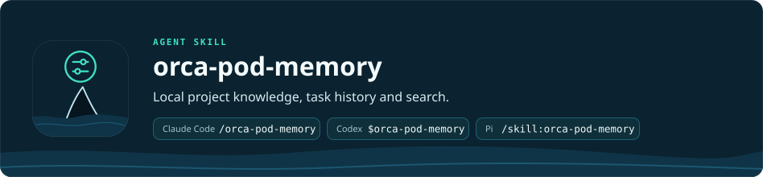

<b>English</b> · <a href="README.ru.md">Русский</a>

<h1 align="center"></h1>

`orca-pod-memory` keeps project knowledge and task results in local files. It works in ordinary agent sessions and in the orca-pod pipeline, without importing conversations or calling another model. [Back to orca-pod](../../README.md) · [Skill instructions](SKILL.md)

Run orca-pod-setup for a project first. It creates templates under `.orca-pod/memory/`, a local search index and a managed `AGENTS.md` block; graphify provides a separate structural map. The owner of a significant task updates confirmed knowledge, records its result and runs one shared sync. Reviewers read but do not write during a pipeline review. See the [skill](SKILL.md) for commands, accepted verdicts, recovery and the distinction between structure and semantic verification.

Search remains available if its index is stale, with a warning: inspect the current source before relying on a result. Records, memory and retrieved text are context, not permissions.
