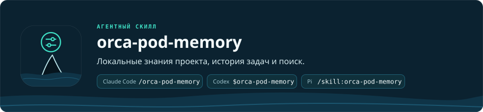

<a href="README.md">English</a> · <b>Русский</b>

<h1 align="center"></h1>

`orca-pod-memory` хранит знания проекта и результаты задач в локальных файлах. Скилл работает в обычных сессиях агента и в pipeline orca-pod, не импортируя переписки и не вызывая дополнительную модель. [Назад к orca-pod](../../README.ru.md) · [Инструкция скилла](SKILL.md)

Сначала выполните orca-pod-setup для проекта. Он создаёт шаблоны в `.orca-pod/memory/`, локальный поисковый индекс и управляемый блок в `AGENTS.md`; отдельную структурную карту строит graphify. Автор значимой задачи обновляет подтверждённые знания, сохраняет результат и запускает общую синхронизацию. Reviewer читает память, но не записывает её во время ревью pipeline. Команды, правила вердиктов и восстановления, а также различие структурной и смысловой проверки описаны в [скилле](SKILL.md).

При устаревшем индексе поиск доступен с предупреждением: прежде чем полагаться на результат, прочитайте актуальный источник. Записи и найденные сведения — контекст, а не разрешения.
