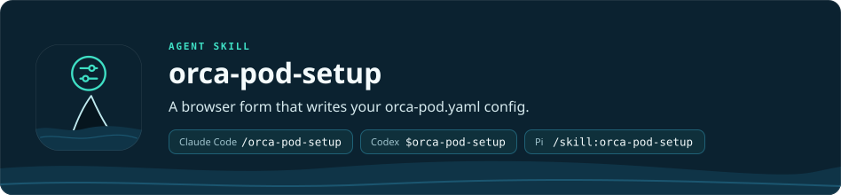

<p align="right"><b>English</b> · <a href="README.ru.md">Русский</a></p>

<h1 align="center"></h1>

This skill creates and changes `.orca-pod/orca-pod.yaml`, the settings file that [orca-pod](../orca-pod/README.md) reads before every run. The file holds profiles: named sets of settings. For each role of orca-pod, a profile says which agent (Pi, Claude Code or Codex), model and thinking level the role uses, which helper subagents it can start and how many subagents it runs at once. There is one file per Git repository, in the main checkout (a linked worktree may have its own). The `.orca-pod/` folder is added to `.gitignore` when the project has one, see step 7; without a `.gitignore`, add it yourself so that the file does not go into git. The old `.orca-pipeline/` (with `orca-pipeline.yaml` and `reports/`) and the `orca-pipeline.yaml` from the project root are moved into `.orca-pod/` automatically.

| Agent | Command |
| --- | --- |
| Claude Code | `/orca-pod-setup` |
| Codex | `$orca-pod-setup` |
| Pi | `/skill:orca-pod-setup` |

Usually the skill is not invoked directly. `orca-pod` invokes it itself if the project has no configuration file.

For the overview, installation and requirements of the whole project, see the [repository README](../../README.md). This file only describes the setup skill.

## Why it is needed

`orca-pod` will not start without `orca-pod.yaml`, and it checks the file strictly. An unknown key, a thinking level that is not supported for the provider, or a wrong helper value stops the launch before any terminal is created. Writing such a file by hand is inconvenient, because:

- each provider has its own set of models and thinking levels;
- for Claude Code subagents a full model id cannot be set, only an alias (`opus`, `sonnet`, `haiku`, `fable`) or `inherit`;
- a helper takes its model or thinking level from its parent role only when the file says `inherit` for it;
- the helper agents must be linked into each agent's folder (`~/.claude/agents/`, `~/.pi/agent/agents/`); `link-agents.sh` does that.

The skill solves this with a visual form in the browser. The form takes the models from each agent's real catalog, validates the fields before saving, and you never edit the YAML by hand.

## What it does

1. Determines the root of the Git repository. Does not create a new repository.
2. Connects the components that do not lie in the skill's folder. Both scripts are idempotent; they do not replace existing regular files or other people's live links and write `SKIP` instead; `link-agents.sh` replaces a dangling link (`RELINK`).
   - `orca-pod/scripts/link-agents.sh` links the helper agents to the Claude Code and Pi directories. A dangling link left by a removed skill version is replaced with ours (`RELINK`); a live link into another installed version stays (`SKIP`).
   - `scripts/link-pi-extension.sh` points `~/.pi/agent/extensions/orca-pod-setup` at the `pi-extension/` of this skill. Without Pi in `PATH` it does nothing. The extension also gives Pi the `orca_pod_ask` question window that the plan-blitz skill uses.
3. Opens the setup form.
   - In Pi it is the `orca_pod_setup` tool; it opens the form in the browser.
   - In Claude Code (and Codex) it is `scripts/setup-form.mjs`, which also prints the form address as `FORM URL:` (open it by hand if the browser does not); Claude Code runs it in the background. Codex runs it as an ordinary command and waits for it.
4. Saves the whole `orca-pod.yaml` with all the profiles from the form. Before writing it checks whether the file has changed and shows "was → now". It does not write secrets into the file.
5. Checks the result with `launch-provider.mjs --profiles` and for each profile reports the roles, the review mode (`full`, `reviewer`, `chief` or `self`) and the subagent limit.
6. Asks whether to add the Codex rule. If a profile without `full_access` has a Codex role and the rule is missing, the skill asks once whether to allow all `orca` commands in Codex without confirmation. Only after you answer "yes" does it add the line `prefix_rule(pattern=["orca"], decision="allow")` to `~/.codex/rules/default.rules`. With "no" the Codex roles will ask for confirmation of `orca` commands.
7. Adds `.orca-pod/` to the project's `.gitignore` (`scripts/ensure-gitignore.sh`). The pipeline writes the review reports there. The script changes only an existing `.gitignore`: if there is none, it does not create it, and if the folder is already ignored, it changes nothing.

How the form is organised:

- **Profiles** are tabs at the top. "Add profile" creates a copy of the current one. A profile has a name, the "Default profile" mark, the default agent, "Concurrent subagents" (1–100, 6 by default) and the "Full access" switch (`full_access`, off by default: when it is on, Codex and Claude Code roles skip their permission prompts and run without a sandbox). A profile can be deleted, except the last one. If there are several profiles, `orca-pod` asks before the launch which one to use.
- **Roles.** For each role of a profile you set the agent (default, Pi, Claude Code or Codex), the model, thinking, `use_subagents` and the set of helpers. The `reviewer` and `chief_reviewer` roles are optional: they are added and removed with buttons, and they appear in the file only when added.
- **Language.** The form is bilingual (English and Russian) with an EN/RU switch in the header; its language follows the `language` field of the config, or the browser language when it is `auto`. A language chosen with the EN/RU switch is remembered in this browser during the form session and takes precedence over both.
- **Done.** Press "Generate YAML": the form hands the result to the agent, which validates and saves the file (steps 4 and 5).

## What it does not do

- Does not start roles, the agent CLIs or helper subagents.
- Does not check that you are logged in to an agent or that you can use a model. `--resolve` checks that the CLI is on PATH and, for Codex roles, that the model and thinking are in the Codex catalog.
- Does not choose additional skills for the roles. The Coordinator (the orca-pod session that starts a run) does that (`references/skill-selection.md`).
- Does not choose the profile for a run. The `orca-pod` Coordinator does that, and the choice is not written to the file.

## Requirements

- A project Git repository.
- The `orca-pod` skill installed next to this one: without it the setup stops with a message.
- For the form in Pi: the extension from the `pi-extension/` of this skill. It is connected by the script `scripts/link-pi-extension.sh` (the skill runs it itself at step 2). After it is connected, run `/reload` in Pi.
- For the model catalogs:
  - Pi: the command `pi --list-models`;
  - Claude Code: `claude` in `PATH`;
  - Codex: `codex` in `PATH` (`codex debug models`).
  If an agent is unavailable, it simply does not appear in the list.
- For Codex roles in a profile without `full_access`: the rule `prefix_rule(pattern=["orca"], decision="allow")` in `~/.codex/rules/default.rules` (the skill offers to add it, see step 6; it is not needed with `full_access`).
- Node.js for the form scripts and the catalogs.
- A browser for the form.

## File format

A minimal example. The full template is in [assets/orca-pod.yaml](../orca-pod/assets/orca-pod.yaml).

```yaml
active_profile: sol-quality

profiles:
  sol-quality:
    default_provider: pi
    max_subagents: 6
    roles:
      planner:
        model: openai-codex/gpt-5.6-sol
        thinking: xhigh
        use_subagents: true
        subagents:
          scout:
            model: inherit
            thinking: low
      implementer:
        model: zai/glm-5.3-flash
        thinking: high
        use_subagents: true
```

The model values are taken from the template; replace them with the ones available to you. There can be several profiles; `active_profile` is the default profile. A profile name is letters, digits, `.`, `_`, `-`, without spaces.

### Provider constraints

| | Pi | Claude Code | Codex |
| --- | --- | --- | --- |
| Model | from the list of `pi --list-models` | an alias (`opus`, `sonnet`, `haiku`, `fable`) or a specific version from the catalog | from `codex debug models` (those visible in Codex) |
| thinking | the levels that the model supports | `low`, `medium`, `high`, `xhigh`, `max` | the model's reasoning effort (for example `low`…`ultra`) |
| Helpers | any agent name in pi-subagents; `worker`, `reviewer`, `scout`, `oracle`, `evidence-auditor` run as the skill's `orca-*` agents; `lens-checker` only in Pi | only an alias or `inherit` | any model of the Codex catalog or `inherit`; the `orca_*` agents are registered by the launcher |

The form offers Pi, Claude Code and Codex — those whose model catalog is available on the machine.

## Manual check

```bash
node <skill-dir>/../orca-pod/scripts/launch-provider.mjs --profiles
node <skill-dir>/../orca-pod/scripts/launch-provider.mjs --roles --profile sol-quality
node <skill-dir>/../orca-pod/scripts/launch-provider.mjs --role planner --validate
node <skill-dir>/../orca-pod/scripts/launch-provider.mjs --role planner --resolve
```

- `--profiles` checks every profile and prints their list with a one-line summary.
- `--roles` checks a profile (`active_profile` by default, another one with `--profile <name>`) and prints the configured roles, `reviewMode` and `maxSubagents`.
- `--role <role> --validate` checks the schema of one role.
- `--role <role> --resolve` additionally checks that the CLI is on PATH and, for Codex roles, that the model and thinking are in the Codex catalog (an unavailable catalog adds an entry to the `warnings` array of the JSON output; the `PIPELINE CONFIG WARNING:` lines on stderr appear only when a role is launched). It does not check authorization or access to the model.

`--validate` and `--resolve` are not combined; `--profile` works with all the modes except `--profiles`.

## Layout

```
orca-pod-setup/
├── SKILL.md                              the setup workflow
├── references/
│   ├── settings.md                       the meaning of every field of orca-pod.yaml
│   └── discovery-and-recommendations.md  how to choose helpers and models
├── pi-extension/
│   ├── index.js                          the orca_pod_setup tool for Pi (opens the form) and orca_pod_ask
│   └── ask.js                            the orca_pod_ask question window for Pi (plan-blitz)
└── scripts/
    ├── ensure-gitignore.sh               adds .orca-pod/ to the project's .gitignore
    ├── link-pi-extension.sh              connects the extension to Pi
    ├── setup-form.mjs                    starts the form for Claude Code and Codex
    ├── pipeline-skill.mjs                checks that orca-pod is installed next to it
    ├── pipeline-form.mjs                 the form server and the save validation
    ├── pipeline-form.test.mjs            tests of the form server (node --test)
    ├── i18n.test.mjs                     tests of the form's bilingualism: the EN/RU dictionary, language choice
    ├── catalogs.mjs                      the model catalogs of Pi, Claude Code and Codex
    ├── form/                             the form interface: index.html, form.css, form.js, i18n.mjs (EN/RU)
    └── vendor/bootstrap.min.css          a local copy of the form's styles
```

## Related documents

- [orca-pod](../orca-pod/README.md): the pipeline that reads this file.
- [SKILL.md](SKILL.md): the full setup workflow.
- [references/settings.md](references/settings.md): the description of all the configuration fields.
