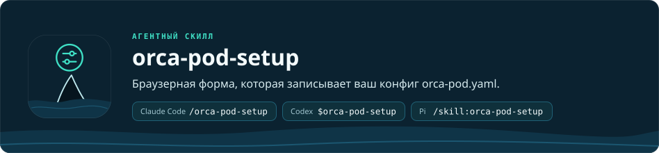

<p align="right"><a href="README.md">English</a> · <b>Русский</b></p>

<h1 align="center"></h1>

Этот скилл создаёт и изменяет `.orca-pod/orca-pod.yaml` — файл настроек, который [orca-pod](../orca-pod/README.ru.md) читает перед каждым запуском. В файле лежат профили — именованные наборы настроек. Для каждой роли orca-pod профиль говорит, какой агент (Pi, Claude Code или Codex), какая модель и какой уровень thinking (глубина рассуждения модели) работают в этой роли, каких субагентов она может запускать и сколько субагентов работает одновременно. Файл один на Git-репозиторий и лежит в основной рабочей копии (main checkout); у дополнительного worktree может быть свой, а у проекта без Git файл лежит в папке проекта. Папка `.orca-pod/` добавляется в `.gitignore`, если в проекте он есть, см. шаг 7; без `.gitignore` добавьте её сами, чтобы файл не попал в git. Старые `.orca-pipeline/` (с `orca-pipeline.yaml` и `reports/`) и `orca-pipeline.yaml` из корня проекта переносятся в `.orca-pod/` автоматически.

| Агент | Команда |
| --- | --- |
| Claude Code | `/orca-pod-setup` |
| Codex | `$orca-pod-setup` |
| Pi | `/skill:orca-pod-setup` |

Обычно скилл напрямую не вызывают. `orca-pod` вызывает его сам, если в проекте нет файла конфига.

Обзор, установка и требования всего проекта — в [README репозитория](../../README.ru.md). Этот файл описывает только скилл настройки.

## Зачем это нужно

`orca-pod` не запустится без `orca-pod.yaml` и проверяет файл строго. Неизвестный ключ, не поддерживаемый провайдером уровень thinking или неверное значение субагента останавливают запуск до создания любого терминала. Писать такой файл вручную неудобно, потому что:

- у каждого провайдера свой набор моделей и уровней thinking;
- для субагентов Claude Code нельзя задать полный id модели, только алиас (`opus`, `sonnet`, `haiku`, `fable`) или `inherit`;
- субагент берёт модель или уровень thinking у своей родительской роли только тогда, когда в файле для него указано `inherit`;
- файлы субагентов должны быть подключены ссылками в папку каждого агента (`~/.claude/agents/`, `~/.pi/agent/agents/`); этим занимается `link-agents.sh`.

Скилл решает эту задачу визуальной формой в браузере. Форма берёт модели из реального каталога каждого агента, проверяет поля до сохранения, и YAML вручную править не нужно.

## Что делает скилл

1. Определяет папку проекта: корень Git-репозитория, а без Git — папку, где вы запустили агента (или ближайшую родительскую папку, где уже есть `.orca-pod/`). Репозиторий не создаёт.
2. Подключает компоненты, которые не лежат в папке скилла. Оба скрипта можно запускать повторно; они не заменяют существующие обычные файлы и чужие живые ссылки и вместо этого пишут `SKIP`; `link-agents.sh` заменяет оборванную ссылку (`RELINK`).
   - `orca-pod/scripts/link-agents.sh` создаёт ссылки на субагентов в каталогах Claude Code и Pi. Оборванная ссылка, оставшаяся от удалённой версии скилла, заменяется ссылкой на текущую (`RELINK`); живая ссылка на другую установленную версию остаётся (`SKIP`).
   - `scripts/link-pi-extension.sh` создаёт ссылку `~/.pi/agent/extensions/orca-pod-setup` на `pi-extension/` этого скилла. Если Pi не установлен (нет `pi` в `PATH` и нет `~/.pi/agent`), скрипт ничего не делает. Расширение работает с Pi и до, и после переименования пакетов в версии 0.74 (`@mariozechner/*` → `@earendil-works/*`). Расширение также даёт Pi окно вопросов `orca_pod_ask`, которое использует скилл plan-blitz.
3. Открывает форму настройки.
   - В Pi это инструмент `orca_pod_setup`; он открывает форму в браузере.
   - В Claude Code (и Codex) это `scripts/setup-form.mjs`, который ещё печатает адрес формы строкой `FORM URL:` (откройте его вручную, если браузер не открылся); Claude Code запускает его в фоне. Codex запускает его как обычную команду и ждёт, с повышенными правами (один раз спрашивает вас): в песочнице Codex форма не может открыть локальный порт, а Pi не может перечислить свои модели.
4. Сохраняет весь `orca-pod.yaml` со всеми профилями из формы. Перед записью проверяет, не изменился ли файл, и показывает «было → стало». Секреты в файл не пишет.
5. Проверяет результат командой `launch-provider.mjs --profiles` и по каждому профилю выводит список ролей, режим ревью (`full`, `reviewer`, `chief` или `self`) и лимит субагентов.
6. Спрашивает, добавлять ли правило Codex. Если у профиля без `full_access` есть роль, которая работает в Codex, а правила нет, скилл один раз спрашивает, разрешить ли все команды `orca` в Codex без подтверждения. Только после вашего «да» он добавляет строку `prefix_rule(pattern=["orca"], decision="allow")` в `~/.codex/rules/default.rules`. При «нет» роли Codex будут просить подтверждения команд `orca`.
7. Добавляет `.orca-pod/` в `.gitignore` проекта (`scripts/ensure-gitignore.sh`; без Git этот шаг пропускается). Пайплайн пишет туда отчёты ревью. Скрипт меняет только существующий `.gitignore`: если файла нет, скрипт его не создаёт, а если папка уже игнорируется, ничего не меняет.

Как устроена форма:

- **Профили** — вкладки вверху. «Добавить профиль» (Add profile) создаёт копию текущего. У профиля есть имя, отметка «Профиль по умолчанию» (Default profile), агент по умолчанию, «Субагентов одновременно» (Concurrent subagents; 1–100, по умолчанию 6) и переключатель «Полные права» (Full access; `full_access`, по умолчанию выключен: когда он включён, роли Codex и Claude Code пропускают запросы разрешений и работают без песочницы). Профиль можно удалить, кроме последнего. Если профилей несколько, `orca-pod` перед запуском спрашивает, какой использовать.
- **Роли.** Для каждой роли профиля задаются агент (по умолчанию, Pi, Claude Code или Codex), модель, thinking, `use_subagents` и набор субагентов. Роли `reviewer` и `chief_reviewer` необязательны: они добавляются и удаляются кнопками и попадают в файл только после добавления.
- **Язык.** Форма двуязычная (английский и русский) с переключателем EN/RU в шапке; язык формы берётся из поля `language` конфига, а если там `auto` — из языка браузера. Язык, выбранный переключателем EN/RU, запоминается в этом браузере на время сессии формы и важнее обоих этих источников.
- **Готово.** Нажмите «Сгенерировать YAML» (Generate YAML): форма передаёт результат агенту, который проверяет и сохраняет файл (шаги 4 и 5).

## Чего скилл не делает

- Не запускает роли, CLI агентов и субагентов.
- Не проверяет, что вы вошли в аккаунт агента и можете пользоваться моделью. `--resolve` проверяет, что CLI найден в PATH или в обычных папках установки и, для ролей Codex, что модель и thinking есть в каталоге Codex.
- Не выбирает дополнительные скиллы для ролей. Это делает Coordinator (сессия orca-pod, из которой начинается запуск) (`references/skill-selection.md`).
- Не выбирает профиль для запуска. Это делает Coordinator в `orca-pod`, и выбор в файл не записывается.

## Требования

- Папка проекта; Git не обязателен.
- Скилл `orca-pod`, установленный рядом с этим: без него настройка останавливается с сообщением.
- Для формы в Pi: расширение из `pi-extension/` этого скилла. Его подключает скрипт `scripts/link-pi-extension.sh` (скилл запускает его сам на шаге 2). После подключения выполните `/reload` в Pi.
- Для каталогов моделей:
  - Pi: команда `pi --list-models`;
  - Claude Code: `claude` в `PATH`;
  - Codex: `codex` в `PATH` (`codex debug models`).
  Если CLI агента нет в `PATH`, он ищется и в обычных папках установки (`~/.local/bin`, `~/.claude/local`, папка запущенного `node`, nvm, Volta, Bun, pnpm, Homebrew); `ORCA_POD_BIN_DIRS` заменяет этот список. Если агент недоступен, он просто не появляется в списке, а его строка `CATALOG` объясняет почему.
- Для ролей Codex в профиле без `full_access`: правило `prefix_rule(pattern=["orca"], decision="allow")` в `~/.codex/rules/default.rules` (скилл предлагает его добавить, см. шаг 6; с `full_access` оно не нужно).
- Node.js для скриптов формы и каталогов.
- Браузер для формы.

## Формат файла

Минимальный пример. Полный шаблон — в [assets/orca-pod.yaml](../orca-pod/assets/orca-pod.yaml).

```yaml
active_profile: sol-quality

profiles:
  sol-quality:
    default_provider: pi
    max_subagents: 6
    roles:
      planner:
        model: openai-codex/gpt-5.6-sol
        thinking: xhigh
        use_subagents: true
        subagents:
          scout:
            model: inherit
            thinking: low
      implementer:
        model: zai/glm-5.3-flash
        thinking: high
        use_subagents: true
```

Значения моделей взяты из шаблона; замените их на те, что доступны вам. Профилей может быть несколько; `active_profile` — профиль по умолчанию. Имя профиля может содержать буквы, цифры, `.`, `_` и `-`, но не пробелы.

### Ограничения провайдеров

| | Pi | Claude Code | Codex |
| --- | --- | --- | --- |
| Модель | из списка `pi --list-models` | алиас (`opus`, `sonnet`, `haiku`, `fable`) или конкретная версия из каталога | из `codex debug models` (видимые в Codex) |
| thinking | уровни, которые поддерживает модель | `low`, `medium`, `high`, `xhigh`, `max` | уровень thinking модели (в Codex это reasoning effort, например `low`…`ultra`) |
| Субагенты | любое имя субагента из pi-subagents; `worker`, `reviewer`, `scout`, `oracle`, `evidence-auditor` запускаются как субагенты `orca-*` из скилла; `lens-checker` только в Pi | только алиас или `inherit` | любая модель каталога Codex или `inherit`; субагентов `orca_*` регистрирует скрипт запуска |

Форма предлагает Pi, Claude Code и Codex — те, у которых на машине доступен каталог моделей.

## Ручная проверка

```bash
node <skill-dir>/../orca-pod/scripts/launch-provider.mjs --profiles
node <skill-dir>/../orca-pod/scripts/launch-provider.mjs --roles --profile sol-quality
node <skill-dir>/../orca-pod/scripts/launch-provider.mjs --role planner --validate
node <skill-dir>/../orca-pod/scripts/launch-provider.mjs --role planner --resolve
```

- `--profiles` проверяет каждый профиль и печатает их список с однострочной сводкой.
- `--roles` проверяет профиль (по умолчанию `active_profile`, другой — через `--profile <name>`) и печатает настроенные роли, `reviewMode` и `maxSubagents`.
- `--role <role> --validate` проверяет схему одной роли.
- `--role <role> --resolve` дополнительно проверяет, что CLI найден в PATH или в обычных папках установки и, для ролей Codex, что модель и thinking есть в каталоге Codex (недоступный каталог добавляет запись в массив `warnings` JSON-вывода; строки `PIPELINE CONFIG WARNING:` в stderr появляются только при запуске роли). Авторизацию и доступ к модели он не проверяет.

`--validate` и `--resolve` нельзя использовать вместе; `--profile` работает со всеми режимами, кроме `--profiles`.

## Структура

```
orca-pod-setup/
├── SKILL.md                              рабочий процесс настройки
├── references/
│   ├── settings.md                       смысл каждого поля orca-pod.yaml
│   └── discovery-and-recommendations.md  как выбирать субагентов и модели
├── pi-extension/
│   ├── index.js                          инструмент orca_pod_setup для Pi (открывает форму) и orca_pod_ask
│   └── ask.js                            окно вопросов orca_pod_ask для Pi (plan-blitz)
└── scripts/
    ├── ensure-gitignore.sh               добавляет .orca-pod/ в .gitignore проекта
    ├── link-pi-extension.sh              подключает расширение к Pi
    ├── setup-form.mjs                    запускает форму для Claude Code и Codex
    ├── pipeline-skill.mjs                проверяет, что рядом установлен orca-pod
    ├── pipeline-form.mjs                 сервер формы и проверка при сохранении
    ├── pipeline-form.test.mjs            тесты сервера формы (node --test)
    ├── i18n.test.mjs                     тесты двуязычности формы: словарь EN/RU, выбор языка
    ├── catalogs.mjs                      каталоги моделей Pi, Claude Code и Codex
    ├── form/                             интерфейс формы: index.html, form.css, form.js, i18n.mjs (EN/RU)
    └── vendor/bootstrap.min.css          локальная копия стилей формы
```

## Связанные документы

- [orca-pod](../orca-pod/README.ru.md): пайплайн, который читает этот файл.
- [SKILL.md](SKILL.md): полный рабочий процесс настройки.
- [references/settings.md](references/settings.md): описание всех полей конфигурации.
