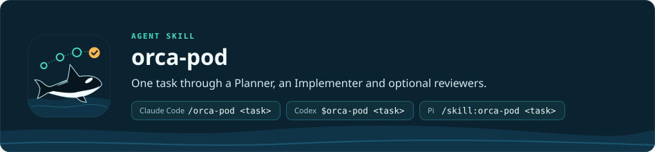

<p align="right"><b>English</b> · <a href="README.ru.md">Русский</a></p>

<h1 align="center"></h1>

`orca-pod` is an agent skill that takes one coding task through a spec and a plan that you approve, then through
implementation and an optional independent review, in Claude Code, Codex or Pi. You start it from your agent
session, and each role runs in its own terminal in [Orca](https://www.onorca.dev) (the app that opens and manages these
terminals; its command is `orca`). Use it when a task needs an approved plan before any code is written. The run ends with a final status:
`FINAL_APPROVED`, `SELF_VERIFIED` or `BLOCKED`.

```
/orca-pod <RAF task path | task description>
```

- **Input:** a path to a RAF task file (your raw, unstructured spec in your own words; a path takes priority) or a non-empty text description of the task.
- **Output:** the spec and the plan in `docs/superpowers/` of your project, code changes, review or self-check reports in `<git-root>/.orca-pod/reports/<planVersion>/` (`<planVersion>` is the version of the approved plan) and the final status.

For the overview, installation and requirements, see the [repository README](../../README.md).
This file only describes the skill itself. The full workflow and the rules that every role follows are in
[SKILL.md](SKILL.md); the configuration is set up by [orca-pod-setup](../orca-pod-setup/README.md).

## Invocation

| Agent | Command |
| --- | --- |
| Claude Code | `/orca-pod <task description or RAF path>` |
| Codex | `$orca-pod <task description or RAF path>` |
| Pi | `/skill:orca-pod <task description or RAF path>` |

```
/orca-pod path/to/task.md          # a task from a file
/orca-pod "Add CSV export"         # a task as text
/orca-pod test                     # a run on the demo task
/orca-pod test check               # check the result of the test run (--profile <name> if not the default profile)
/orca-pod test reset               # reset the test sandbox
```

The test mode (`test`) runs the whole process on a built-in demo task in the sandbox
`~/orca-pod-test`. The current project is not changed. The expected course is
described in `assets/test/EXPECTED.md`.

## Roles and review modes

| Role | What it does | Required |
| --- | --- | --- |
| Coordinator | The session where you start the run. Checks the config, asks for the profile (if there are several) and for the additional skills each role should use, creates the role terminals, sends the task to Planner and exits. Does not change application code | — |
| Planner | Chooses the architecture, writes the spec and plan (TODOs with `dependsOn` and `writeScope`, waves, stages), walks you through each in plan-blitz rounds of questions and gets your approval | yes |
| Implementer | Also called the integrator: runs waves of workers (subagents that each carry out one TODO), merges shared files, runs the checks, sends one `REVIEW_REQUEST` per stage | yes |
| Reviewer | Batch review by parallel lanes (each lane checks one slice of the change), findings registry, stage verdict | no |
| Chief Reviewer | Final review of all the code; the only `FINAL_APPROVED` in the `full` mode | no |

The review mode is set by the roles configured in the selected profile of `orca-pod.yaml`:

| Mode | Roles | Who accepts the stages | Who issues the final |
| --- | --- | --- | --- |
| `full` | Reviewer + Chief Reviewer | Reviewer | Chief Reviewer (`FINAL_APPROVED`) |
| `reviewer` | Reviewer only | Reviewer | Reviewer (`FINAL_APPROVED`) |
| `chief` | Chief Reviewer only | Chief Reviewer | Chief Reviewer (`FINAL_APPROVED`) |
| `self` | no reviewers | Implementer (self-check) | Implementer (`SELF_VERIFIED`) |

Findings have four severities: `BLOCKER`, `MAJOR`, `MINOR` and `NIT`. Only `BLOCKER` and `MAJOR` block. Review is
limited: up to 3 rounds per stage and up to 2 attempts for the chief review (3 when the Chief Reviewer is the only
reviewer); if it does not converge, the status becomes `BLOCKED` and you decide.

Each profile has its own concurrent-subagent limit (`max_subagents`, 6 by default,
up to 100) and a `full_access` switch. `full_access` is off by default; when it is
on, Codex and Claude Code roles skip their permission prompts and run without a sandbox.
The roles, models and profiles are all set in `orca-pod.yaml`.

## Requirements

- A project Git repository and `.orca-pod/orca-pod.yaml` — one per repository, in the
  main checkout; the `.orca-pod/` folder is added to `.gitignore` when the project has one. The file is created by
  `/orca-pod-setup`; the old `.orca-pipeline/` and `orca-pipeline.yaml` are migrated
  automatically.
- Orca with the `orca` command, and the `orca-cli` skill. Orca installs the skill itself:
  `orca skills install --skill orca-cli`. Check with `orca skills installed`. Without
  the skill the pipeline does not stop and relies on `orca --help`.
- Pi, Claude Code and/or Codex.
  - Pi needs the subagent package `npm:pi-subagents` version 0.78.0. Do not install
    `pi-interactive-subagents` next to it: both packages provide the `subagent` tool
    and conflict. The Pi helpers from `agents/pi/` are linked into `~/.pi/agent/agents/`
    by `scripts/link-agents.sh`; the `orca-*` ones start without your Pi extensions, so
    pi-lens (and its `tsserver`) runs only in the role and in at most one helper.
  - For Claude Code, the helpers from `agents/claude/` are linked into `~/.claude/agents/`
    by `scripts/link-agents.sh`.
  - For Codex, the launcher registers the helpers from `agents/codex/` (`orca_worker`,
    `orca_scout`, etc.) itself when it starts a role — only in that role's session. For
    the roles to call `orca` from the Codex sandbox, the rule
    `prefix_rule(pattern=["orca"], decision="allow")` is needed in
    `~/.codex/rules/default.rules`; `orca-pod-setup` offers it (not needed when the
    profile uses `full_access`).
- The superpowers skills (a separate set of planning skills) `using-superpowers`, `brainstorming` and
  `writing-plans`. The Planner uses them without exception, so install them for every agent that will run a Planner.
- Optional: the `plan-blitz` skill from this repository, installed next to `orca-pod`: before each
  approval the Planner walks you through the spec or the plan, asking multiple-choice questions only
  where there is a real choice. Without it the Planner warns you in one line and asks for approval in
  plain text.
- Node.js for `scripts/launch-provider.mjs`.

## Layout

```
orca-pod/
├── SKILL.md                 the main workflow and invariants
├── agents/
│   ├── claude/*.md          helpers for Claude Code: scout, worker, reviewer,
│   │                        researcher, oracle, evidence-auditor, verifier
│   ├── pi/*.md              helpers for Pi: lens-checker, verifier and orca-*
│   │                        (worker, reviewer, scout, oracle, evidence-auditor
│   │                        without your extensions)
│   ├── codex/*.toml         helpers for Codex (orca_*), registered by the launcher
│   └── openai.yaml          metadata for displaying the skill in the UI
├── assets/
│   ├── orca-pod.yaml        configuration template
│   └── test/                the demo task, the hint for Implementer, the expected course
├── references/
│   ├── review-protocol.md        severity scale, registry, review rounds, reports
│   ├── handoff-contracts.md      the format of messages between roles
│   ├── subagents.md              the helper catalog and delegation rules
│   └── skill-selection.md        choosing additional skills for the roles
└── scripts/
    ├── launch-provider.mjs  launches a role in the chosen provider, validates the config, lists profiles
    ├── pipeline-config.mjs  the orca-pod.yaml schema: parsing, profiles, summaries (shared with the setup form)
    ├── config-location.mjs  where the config lives (.orca-pod/, one per repository) and migration of old layouts
    ├── codex-models.mjs     the Codex model catalog: codex debug models, fallback — models_cache.json
    ├── provider-command.mjs the command that launches a role in a provider (Codex: effort, limit, orca_* agents)
    ├── link-agents.sh       links the helpers into the providers' directories
    └── test-sandbox.mjs     prepares and checks the test sandbox
```

Review and self-check reports are written into the project, not into the skill
folder: `<git-root>/.orca-pod/reports/<planVersion>/` (the format is in
`references/review-protocol.md`, section 7). The `.orca-pod/` folder is added to the
project's `.gitignore` by `orca-pod-setup/scripts/ensure-gitignore.sh`, and only if a
`.gitignore` already exists; the script does not create the file.

## What the skill does not do

- It does not create worktrees. Git writes (commit, push, stash, reset, branch) are made
  only with separate permission; reading is allowed (the one exception is the baseline commit that test mode
  makes inside its sandbox).
- The Coordinator does not change application code (its only edit in the project is the
  `.orca-pod/` line in an existing `.gitignore`) and does not follow the run after it hands the
  task to the Planner.
- Reviewers do not write code and do not run build, test or lint.
- It does not write, change or run tests and does not follow TDD unless you ask for tests
  in the task or in a message to a role; the checks are static (analyzer, linter, typecheck).
- Helper subagents make no decisions about the plan, a stage or the final status.
- It does not resume an interrupted run — a new run is a new invocation of the skill.
- It does not work without Orca: all roles run in its terminals.
