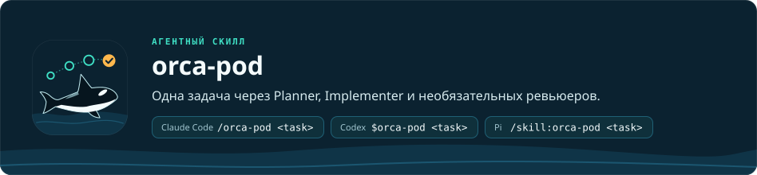

<p align="right"><a href="README.md">English</a> · <b>Русский</b></p>

<h1 align="center"></h1>

`orca-pod` — скилл для ИИ-агентов, который проводит одну задачу по программированию через спецификацию и план, которые
вы утверждаете, затем через реализацию и необязательное независимое ревью — в Claude Code, Codex или Pi. Вы запускаете
его из сессии своего агента, а каждая роль работает в своём терминале в [Orca](https://www.onorca.dev) (приложении, которое открывает такие
терминалы и управляет ими; его команда — `orca`). Он нужен, когда задаче требуется утверждённый план ещё до того, как
написан первый код. Запуск заканчивается итоговым статусом: `FINAL_APPROVED`, `SELF_VERIFIED` или `BLOCKED`.

```
/orca-pod <RAF task path | task description>
```

- **Вход:** путь к файлу задачи RAF (ваша сырая, неструктурированная спецификация своими словами; путь важнее текста) или непустое текстовое описание задачи.
- **Выход:** спецификация и план в `docs/superpowers/` вашего проекта, изменения кода, отчёты ревью или самопроверки в `<project-root>/.orca-pod/reports/<planVersion>/` (`<planVersion>` — версия утверждённого плана) и итоговый статус.

Обзор, установка и требования — в [README репозитория](../../README.ru.md).
Этот файл описывает только сам скилл. Полный рабочий процесс и правила, которым подчиняются все роли, — в
[SKILL.md](SKILL.md); конфиг настраивается скиллом [orca-pod-setup](../orca-pod-setup/README.ru.md).

## Вызов

| Агент | Команда |
| --- | --- |
| Claude Code | `/orca-pod <task description or RAF path>` |
| Codex | `$orca-pod <task description or RAF path>` |
| Pi | `/skill:orca-pod <task description or RAF path>` |

```
/orca-pod path/to/task.md          # задача из файла
/orca-pod "Add CSV export"         # задача текстом
/orca-pod test                     # запуск на демо-задаче
/orca-pod test check               # проверить результат тестового запуска (--profile <name>, если профиль не по умолчанию)
/orca-pod test reset               # сбросить тестовую песочницу
```

Тестовый режим (`test`) запускает весь процесс на встроенной демо-задаче в песочнице
`~/orca-pod-test`. Текущий проект не меняется. Ожидаемый сценарий описан
в `assets/test/EXPECTED.md`.

## Роли и режимы ревью

| Роль | Что делает | Обязательна |
| --- | --- | --- |
| Coordinator | Сессия, из которой вы запускаете задачу. Проверяет конфиг, спрашивает профиль (если их несколько) и какие дополнительные скиллы нужны каждой роли, создаёт терминалы ролей, отправляет задачу Planner и завершается. Код приложения не меняет | — |
| Planner | Выбирает архитектуру, пишет спецификацию и план (TODO с `dependsOn` и `writeScope`, волны, этапы), проводит вас по каждому из них раундами вопросов plan-blitz и получает ваше утверждение | да |
| Implementer | Он же интегратор: запускает волны worker (субагентов, каждый из которых выполняет один TODO), сводит общие файлы, запускает проверки, отправляет по одному `REVIEW_REQUEST` на этап | да |
| Reviewer | Пакетное ревью параллельными lanes (каждая проверяет свой срез изменений), реестр замечаний, вердикт по этапу | нет |
| Chief Reviewer | Финальное ревью всего кода; единственный, кто выдаёт `FINAL_APPROVED` в режиме `full` | нет |

Режим ревью определяется ролями, настроенными в выбранном профиле `orca-pod.yaml`:

| Режим | Роли | Кто принимает этапы | Кто выносит финальный вердикт |
| --- | --- | --- | --- |
| `full` | Reviewer + Chief Reviewer | Reviewer | Chief Reviewer (`FINAL_APPROVED`) |
| `reviewer` | только Reviewer | Reviewer | Reviewer (`FINAL_APPROVED`) |
| `chief` | только Chief Reviewer | Chief Reviewer | Chief Reviewer (`FINAL_APPROVED`) |
| `self` | нет ролей ревью | Implementer (самопроверка) | Implementer (`SELF_VERIFIED`) |

У замечаний четыре степени серьёзности: `BLOCKER`, `MAJOR`, `MINOR` и `NIT`. Блокируют только `BLOCKER` и `MAJOR`.
Ревью ограничено: до 3 раундов на этап и до 2 попыток финального ревью (3, если Chief Reviewer — единственная роль
ревью); если за отведённые раунды одобрения нет, статус становится `BLOCKED`, и решение за вами.

У каждого профиля свой лимит одновременно работающих субагентов (`max_subagents`, по умолчанию 6,
максимум 100) и переключатель `full_access`. `full_access` по умолчанию выключен; когда он
включён, роли Codex и Claude Code пропускают запросы разрешений и работают без песочницы.
Роли, модели и профили задаются в `orca-pod.yaml`.

## Требования

- Папка проекта (Git не обязателен) и `.orca-pod/orca-pod.yaml` — один на репозиторий, в
  основной рабочей копии (main checkout), а без Git — один в папке проекта. Без Git ревью читает изменённые файлы по
  списку от Implementer вместо диффа, поэтому изменение вне этого списка ревью не увидит. Папка `.orca-pod/` добавляется в `.gitignore`, если в проекте он есть. Файл создаётся
  командой `/orca-pod-setup`; старые `.orca-pipeline/` и `orca-pipeline.yaml` переносятся
  автоматически.
- Orca с командой `orca` и скилл `orca-cli`. Orca устанавливает скилл сама:
  `orca skills install --skill orca-cli`. Проверить можно командой `orca skills installed`. Без
  скилла пайплайн не останавливается и опирается на `orca --help`.
- Pi, Claude Code и/или Codex.
  - Pi нужен npm-пакет субагентов `npm:pi-subagents` версии 0.78.0. Не ставьте рядом
    `pi-interactive-subagents`: оба пакета дают инструмент `subagent`
    и конфликтуют. Субагентов Pi из `agents/pi/` подключает ссылками в `~/.pi/agent/agents/`
    скрипт `scripts/link-agents.sh`; субагенты `orca-*` запускаются без ваших расширений Pi, поэтому
    pi-lens (и его `tsserver`) работает только в самой роли и не более чем в одном субагенте.
  - Для Claude Code субагентов из `agents/claude/` подключает ссылками в `~/.claude/agents/`
    скрипт `scripts/link-agents.sh`.
  - Для Codex субагентов из `agents/codex/` (`orca_worker`,
    `orca_scout` и др.) регистрирует сам скрипт запуска при старте роли — только в сессии этой роли. Чтобы
    роли могли вызывать `orca` из песочницы Codex, нужно правило
    `prefix_rule(pattern=["orca"], decision="allow")` в
    `~/.codex/rules/default.rules`; `orca-pod-setup` предлагает его (не нужно, когда
    профиль использует `full_access`).
- Скиллы superpowers (отдельный набор скиллов для планирования) `using-superpowers`, `brainstorming` и
  `writing-plans`. Planner использует их без исключений, поэтому установите их для каждого агента, на котором будет работать Planner.
- По желанию: скилл `plan-blitz` из этого репозитория, установленный рядом с `orca-pod`: перед каждым
  утверждением Planner проводит вас по спецификации или плану и задаёт вопросы с вариантами
  ответа только там, где есть настоящий выбор. Без него Planner одной строкой предупреждает вас и
  просит утвердить обычным текстом.
- Node.js для `scripts/launch-provider.mjs`.

## Структура

```
orca-pod/
├── SKILL.md                 основной рабочий процесс и инварианты
├── agents/
│   ├── claude/*.md          субагенты для Claude Code: scout, worker, reviewer,
│   │                        researcher, oracle, evidence-auditor, verifier
│   ├── pi/*.md              субагенты для Pi: lens-checker, verifier и orca-*
│   │                        (worker, reviewer, scout, oracle, evidence-auditor
│   │                        без ваших расширений)
│   ├── codex/*.toml         субагенты для Codex (orca_*), регистрируются скриптом запуска
│   └── openai.yaml          метаданные для показа скилла в интерфейсе
├── assets/
│   ├── orca-pod.yaml        шаблон конфигурации
│   └── test/                демо-задача, подсказка для Implementer, ожидаемый сценарий
├── references/
│   ├── review-protocol.md        шкала серьёзности, реестр, раунды ревью, отчёты
│   ├── handoff-contracts.md      формат сообщений между ролями
│   ├── subagents.md              каталог субагентов и правила делегирования
│   └── skill-selection.md        выбор дополнительных скиллов для ролей
└── scripts/
    ├── launch-provider.mjs  запускает роль в выбранном провайдере, проверяет конфиг, выводит список профилей
    ├── pipeline-config.mjs  схема orca-pod.yaml: разбор, профили, сводки (общая с формой настройки)
    ├── config-location.mjs  где лежит конфиг (.orca-pod/, один на репозиторий) и перенос старых вариантов структуры
    ├── codex-models.mjs     каталог моделей Codex: codex debug models, запасной вариант — models_cache.json
    ├── provider-command.mjs команда, которая запускает роль в провайдере (Codex: effort, лимит, субагенты orca_*)
    ├── link-agents.sh       создаёт ссылки на субагентов в каталогах провайдеров
    └── test-sandbox.mjs     готовит и проверяет тестовую песочницу
```

Отчёты ревью и самопроверки записываются в проект, а не в папку скилла:
`<project-root>/.orca-pod/reports/<planVersion>/` (формат описан в
`references/review-protocol.md`, раздел 7). Папку `.orca-pod/` добавляет в
`.gitignore` проекта скрипт `orca-pod-setup/scripts/ensure-gitignore.sh`, и только если
`.gitignore` уже есть; сам `.gitignore` скрипт не создаёт.

## Чего скилл не делает

- Не создаёт worktree. Команды, которые меняют git (commit, push, stash, reset, branch), выполняются
  только с отдельного разрешения; чтение разрешено (единственное исключение — базовый коммит, который тестовый режим
  делает внутри своей песочницы).
- Coordinator не меняет код приложения (его единственная правка в проекте — строка
  `.orca-pod/` в уже существующем `.gitignore`) и не следит за запуском после того,
  как передал задачу Planner.
- Роли ревью не пишут код и не запускают сборку, тесты и линтер.
- Скилл не пишет, не меняет и не запускает тесты и не работает по TDD (разработка через тесты), если вы не попросили
  тесты в задаче или в сообщении роли; проверки статические (анализатор, линтер, проверка типов).
- Субагенты не принимают решений о плане, этапе или итоговом статусе.
- Не возобновляет прерванный запуск — новый запуск это новый вызов скилла.
- Не работает без Orca: все роли работают в её терминалах.
