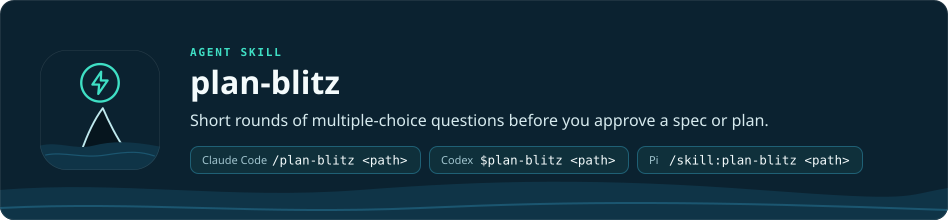

<b>English</b> · <a href="README.ru.md">Русский</a>

<h1 align="center"></h1>

`plan-blitz` is an agent skill that walks you through a spec or an implementation plan before you approve it, so you
can decide without reading the whole document. It goes by the document only: it does not check your project, and it
is not a quality review. A blitz has four steps:

1. **Overview.** A short summary of what will happen. For a plan it comes with a map of the tasks: what each one does,
   what it waits for, whether it runs in parallel and how it is checked.
2. **Questions**, only where there is a real choice. Each comes with a card: the Situation (what is there now), the
   Proposal (the decision and what you get), the Cost (what you will notice) and, when there is a real alternative,
   Otherwise (that alternative and its cost). The first option is the proposal, marked "(proposed)"; "Explain
   simpler" comes last (a question asked again does not offer it) and explains the question in chat on an everyday
   example; you can also type your own answer.
   For a plan, every place where it changes the spec is a question too. The wording is plain, without code or
   technical terms, and in your language.
3. **More rounds.** Answers that change something are written into the document. The next round asks only about what
   is still open, new or changed by an answer; a round holds at most 8 questions.
4. **Approval.** When nothing is open, the blitz lists the decisions it made without asking, each with its cost, and
   asks you to approve: Approve, Read it in full first or, if there were questions, Back to a question (give its
   number), which reopens it for another round. The blitz prepares the approval and does not replace it.

You can run it yourself on a spec or plan file. In an [orca-pod](../orca-pod/README.md) run, the Planner (the role
that writes the spec and the plan) runs it on its own before the spec is approved, before the plan is approved and
again for a plan revision, where it covers only what changed.

| Agent | Command |
| --- | --- |
| Claude Code | `/plan-blitz <path to the spec or plan>` |
| Codex | `$plan-blitz <path>` |
| Pi | `/skill:plan-blitz <path>` |

The questions appear in the agent's own question window: `AskUserQuestion` in Claude Code, `request_user_input` in
Codex (for a manual run start Codex with `codex --enable default_mode_request_user_input`), `orca_pod_ask` in Pi (the
extension that orca-pod-setup links; run `/reload` in Pi after setup). In Codex each window holds one question and
closes by itself after about two minutes unless you press a key; the blitz then asks again. If the agent has no such
window, the blitz prints the questions as a numbered list and you answer by number or in words. In Codex the approval
is always a numbered list, not a window.

The rules are in [SKILL.md](SKILL.md). For installation, see the [repository README](../../README.md).
