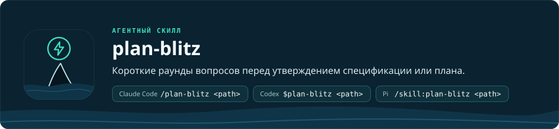

<a href="README.md">English</a> · <b>Русский</b>

<h1 align="center"></h1>

`plan-blitz` — скилл для ИИ-агентов, который проводит вас по спецификации или плану реализации, прежде чем вы их
утвердите, чтобы вы могли решить, не читая документ целиком. Он опирается только на сам документ: ваш проект он не
проверяет, и это не проверка качества. Blitz проходит в четыре шага:

1. **Обзор.** Сначала строка с путём к документу, чтобы его можно было открыть и сверить с ним любую карточку; потом
   краткая сводка того, что будет происходить. Для плана к нему добавляется карта задач: что делает каждая, чего
   ждёт, идёт ли параллельно и как проверяется.
2. **Вопросы** — только там, где есть настоящий выбор. К каждому прилагается карточка: Ситуация (что есть сейчас),
   Предложение (решение и что вы получите), Цена (что вы заметите) и, если есть настоящая альтернатива, Иначе (эта
   альтернатива и её цена). Первый вариант — предложение, с пометкой «(предложено)»; «Объясни проще» идёт последним (в повторном вопросе его
   нет) и объясняет вопрос в чате на бытовом примере; можно также ввести свой ответ. Для плана вопросом становится и каждое
   место, где он меняет спецификацию или добавляет то, что вы увидите. Формулировки простые, без кода и технических
   слов, на вашем языке. Если настоящего выбора нет, blitz говорит об этом одной строкой и сразу переходит к
   утверждению.
3. **Следующие раунды.** Ответы, которые что-то меняют, вносятся в документ, а в журнал блица в его конце
   добавляется строка на каждый раунд: о чём спросили и что изменилось. Следующий раунд спрашивает только о том,
   что ещё открыто, что добавилось или изменилось из-за ответа; в раунде не больше 8 вопросов.
4. **Утверждение.** Когда открытых пунктов не осталось, blitz показывает путь к документу и перечисляет решения,
   которые принял сам без вопроса, каждое с ценой, и просит утвердить: «Утвердить», «Сначала прочитать целиком» или, если вопросы были, «Вернуться к
   вопросу» (назовите его номер), тогда этот вопрос открывается ещё раз. Blitz готовит утверждение и не заменяет его.

Вы можете запустить скилл и сами на файле спецификации или плана. Когда работает [orca-pod](../orca-pod/README.ru.md),
Planner (роль, которая пишет спецификацию и план) сам запускает blitz: перед утверждением спецификации, перед
утверждением плана и ещё раз при пересмотре плана; тогда blitz охватывает только то, что изменилось.

| Агент | Команда |
| --- | --- |
| Claude Code | `/plan-blitz <path to the spec or plan>` |
| Codex | `$plan-blitz <path>` |
| Pi | `/skill:plan-blitz <path>` |

Вопросы задаются в собственном окне вопросов агента: `AskUserQuestion` в Claude Code, `request_user_input` в Codex
(для ручного запуска запустите Codex командой `codex --enable default_mode_request_user_input`), `orca_pod_ask` в Pi
(расширение, на которое создаёт ссылку orca-pod-setup; после настройки выполните `/reload` в Pi). В Codex каждое окно
содержит один вопрос и закрывается само примерно через две минуты, если не нажать клавишу; тогда blitz спрашивает ещё раз. Если
у агента нет такого окна, blitz печатает вопросы пронумерованным списком, и вы отвечаете номером или словами. В Codex
утверждение всегда идёт пронумерованным списком, а не окном.

Правила описаны в [SKILL.md](SKILL.md). Об установке — в [README репозитория](../../README.ru.md).
